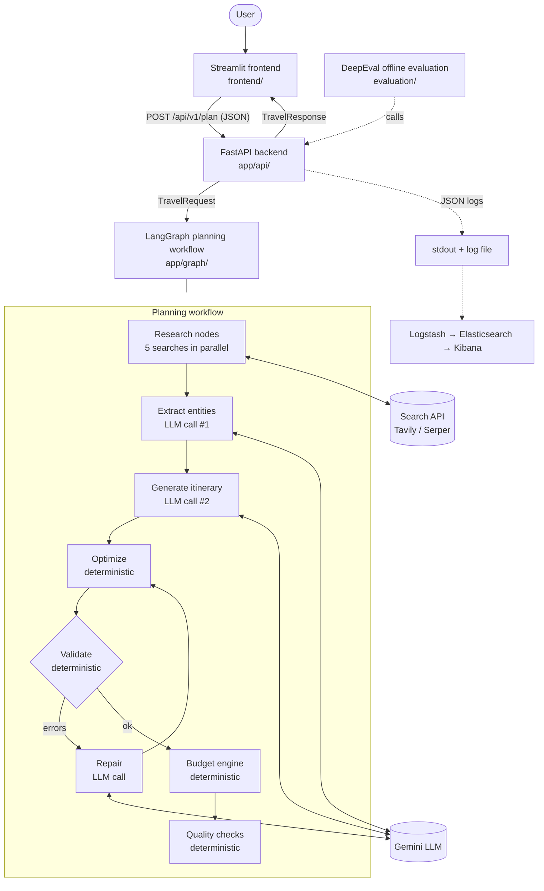
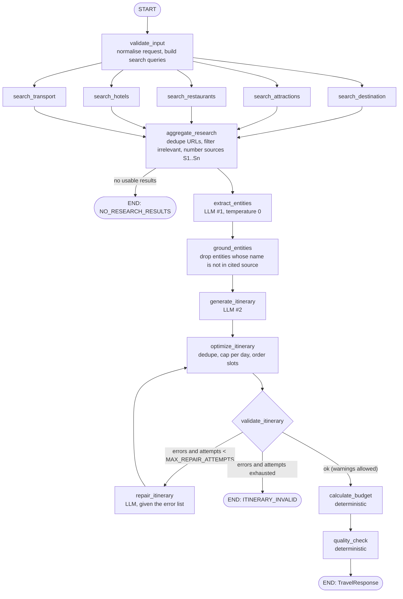
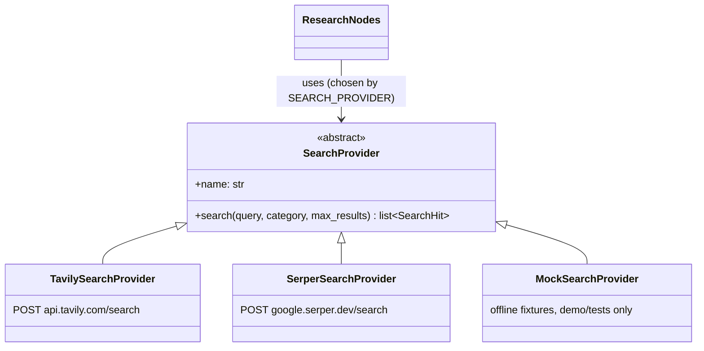
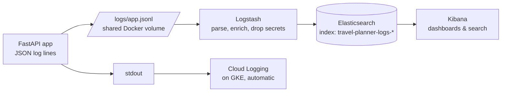
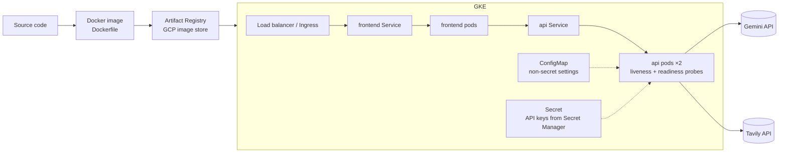
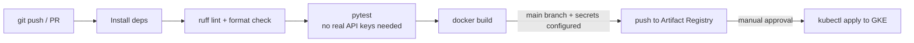

# Architecture — AI Travel Planner

> **Status legend** used throughout this repo:
> ✅ built and tested · 🚧 designed, built in a later stage · 📝 instructions only (not run by the author)
>
> Build stages: **Stage 1** (this) foundations · **Stage 2** AI core · **Stage 3** UI, tests, evaluation ·
> **Stage 4** ops (logging, ELK, Docker, Kubernetes, GCP, CI/CD) · **Stage 5** docs and final audit.

This document is the map of the whole system. Every later file has a place on it. If you only read one design
document, read this one.

---

## 1. The problem

Planning a trip means answering many small questions at once: *what is worth seeing, which areas to stay in,
what to eat given my diet, how to get there, how to fit it into N days, and can I afford it?* The answers depend
on **current** information (prices, closures, new restaurants) and on **personal** preferences that interact
with each other ("relaxed couple trip, vegetarian, beaches and nightlife, ₹25,000 for two").

Today people do this by opening 20 browser tabs and stitching the results together by hand.

**Our system** takes one structured request and returns a day-by-day plan in which every place comes from
current web research, every price says where it came from, and the total cost is calculated by code rather
than guessed.

## 2. Why AI, and why not *only* AI

| Sub-problem | Who does it | Why |
|---|---|---|
| Validate the request (dates, ranges, characters) | **Python / Pydantic** | Hard rules, must be exact |
| Find current places, hotels, transport | **Search API** (Tavily/Serper) | LLM knowledge is frozen at its training date |
| Read messy web snippets and pull out "Fort Aguada, a 17th-century fort in Candolim" | **LLM** | Unstructured language understanding; impossible to write rules for every website |
| Decide which places suit *this* traveller and group them into sensible days | **LLM** | Judgement over many soft, competing preferences |
| Check every scheduled place really came from research | **Python** | Deterministic, cheap, verifiable |
| Remove duplicates, cap activities per day, order by time slot | **Python** | Rules we can state exactly |
| Add up the budget | **Python** | LLMs are unreliable at arithmetic |

**Why a rule-based app can't do it alone.** You could hard-code "Goa → Baga Beach, Fort Aguada" but you would
need a hand-maintained database for every city on Earth, it would go stale, and the rules for "couple who like
food and nightlife, relaxed pace, vegetarian" multiply combinatorially. Reading free web text and making
trade-offs between soft preferences is exactly what LLMs are good at.

**Why an LLM can't do it alone.** Asked "plan 4 days in Goa for ₹25,000", a bare LLM writes a fluent plan with
invented prices, possibly closed restaurants, and sums that don't add up. So we surround the LLM with code that
feeds it facts, constrains its output, checks it, and does the maths.

## 3. Overall architecture



**How to read it:** solid arrows are the request path; dotted arrows are observability and evaluation, which
watch the system but never sit in the user's path. The user waits only for the solid path.

## 4. Where each technology is used (answers to the design questions)

**Q4 — Where exactly is the LLM used?** Three places, all in the workflow, never in the API layer:
1. *Entity extraction* (`research_prompt`, temperature 0): turn search snippets into typed `Attraction`,
   `Restaurant`, `Hotel`, `Transportation` objects, each citing its source.
2. *Itinerary generation* (`planner_prompt`, temperature 0.3): choose and arrange places into days.
3. *Repair* (`repair_prompt`), only when validation fails: fix the listed problems.

**Q5 — Where is LangChain used?** Only where it saves real work:
- `ChatGoogleGenerativeAI`: one interface to Gemini; swapping provider = changing one factory function.
- `ChatPromptTemplate`: prompts as reviewable templates with named variables.
- `.with_structured_output(PydanticModel)`: makes the model return JSON matching our schema, and parses it.
- Token-usage metadata on responses, used for cost tracking.

We do **not** use LangChain's search tool wrappers or agents: our own `SearchProvider` classes are about 60
lines, easier to test, and give us control over timeouts and error mapping.

**Q6 — Where is LangGraph used?** To run the workflow in §5: parallel research branches, a conditional
validate → repair loop with a bounded retry count, and one typed `PlannerState` passed between steps. Without it
we would hand-write the fan-out, the loop and the state bookkeeping.

**Q7 — Where are tools used?** The five research functions (destination, attractions, restaurants, hotels,
transport) are our "tools". We call them deterministically, in parallel, every time. We do *not* let the LLM
decide whether to search (classic agent tool-calling), because a travel plan always needs all five, and
skipping a search is exactly how hallucinations get in. See §6 for this trade-off.

**Q8 — Where does real-time search happen?** In the research nodes, through `app/tools/search/`. That is the
*only* place the system touches the live web.

**Q9 — How is information passed between components?** Always as Pydantic models (typed, validated objects),
never as loose dicts or raw strings:
`TravelRequest → SearchHit[] → ResearchResult → Itinerary → BudgetBreakdown + QualityReport → TravelResponse`.
Inside the workflow these sit as fields of one `PlannerState` object.

**Q10 — How is the itinerary generated?** The LLM receives the user's request plus a numbered list of
researched places (`A1 Fort Aguada — Candolim — [S3]`, …) and must return an `Itinerary` in which every activity
references a place id from that list (or `null` for generic items such as "free time at the beach").

**Q11 — How do we reduce hallucinations?** (Never "prevent": no technique gets that to zero.)

| Technique | What it stops |
|---|---|
| Real-time search before generation | Outdated or imagined places |
| Extracted entities must cite a source; name must appear in that source's text | Invented places in the research step |
| Planner may only use place ids from research | Invented places in the itinerary |
| Structured output + `extra="forbid"` schemas | Free-form text, invented fields like `opening_hours` |
| `cost_basis` (`source` / `estimate` / `unknown`) on every price | Confidently invented prices |
| Time slots (morning/afternoon/evening) instead of clock times | Invented opening hours and timings |
| `uncertainty_notes` field | Model guessing instead of saying "unverified" |
| Deterministic validation + bounded repair loop | Plans that break hard rules reaching the user |
| Budget computed in Python | Arithmetic mistakes |
| Sources returned to the user | Unverifiable claims |

**Q12 — How do we validate the itinerary?** Three layers: (1) Pydantic schema validation of the LLM's JSON;
(2) deterministic business rules: correct number of days, known place ids, no duplicate attractions, activity
cap per pace, slot ordering; (3) quality signals: share of grounded activities, share of sourced prices.
Errors trigger repair; warnings are shown to the user.

**Q13 — How is it monitored?** Every request gets a `request_id`. Each request writes one structured JSON log
line (plus lines for each LLM and search call) with latency, status, model, tokens and error code. `/metrics`
shows live per-process counters. ELK stores the logs and draws dashboards (see §8).

**Q14 — How is the LLM evaluated?** Offline, with DeepEval: a dataset of realistic requests runs through the
real pipeline, and metrics score faithfulness to the retrieved research, relevance to the request, and
constraint adherence (days, diet, budget). Online, every response carries the cheap deterministic
`QualityReport`.

**Q15–17 — Deployment, Kubernetes, GCP.** See §9.

**Q18 — Why ELK?** Logs from several pods and the frontend must be searchable in one place, and must survive
pod restarts. ELK is open source, runs locally in Docker for learning, and Kibana gives dashboards without
writing code. On GCP we would normally use Cloud Logging (built into GKE). We keep ELK for local work and
document both, because both appear in job descriptions and the concepts transfer.

**Q19 — Why DeepEval?** Unit tests check *code* ("does the budget add up?"). They cannot check *language*
("is this plan faithful to the sources and useful?"). DeepEval provides LLM-as-judge metrics (faithfulness,
relevancy, custom G-Eval criteria) inside a pytest-like workflow, so evaluation runs like a test suite.

## 5. The LangGraph workflow 🚧 (Stage 2)



**State passed between nodes** (`PlannerState`, one object that each node reads and adds to):

| Field | Written by | Read by |
|---|---|---|
| `request: TravelRequest` | API | every node |
| `hits: list[SearchHit]` | search nodes (merged with a reducer, because they run in parallel) | aggregate |
| `research: ResearchResult` | aggregate, extract, ground | generate, validate, budget, quality |
| `itinerary: Itinerary` | generate, repair, optimize | validate, budget, quality |
| `issues: list[ValidationIssue]` | validate | router, repair, response |
| `repair_attempts: int` | repair | router |
| `budget: BudgetBreakdown` | budget | response |
| `usage` (LLM calls, tokens, latencies) | LLM and search nodes | response metadata, logs |

**Partial failure policy.** If one search category fails (say hotels time out), the plan continues with a
warning and `status: "partial"`. If *all* searches return nothing usable, we stop with `NO_RESEARCH_RESULTS`
rather than letting the LLM fill the gap from memory.

## 6. Agent or workflow? (an important design choice)

An **agent** lets the LLM decide its next step in a loop ("should I search hotels now?"). A **workflow** fixes
the steps in code and uses the LLM inside specific steps.

We chose a **workflow with one agentic element** (the self-correcting validate → repair loop) because:
- every trip needs the same five kinds of research, so there is nothing for the LLM to decide there;
- fixed steps mean predictable cost (2–4 LLM calls, exactly 5 searches) and latency;
- each step can be unit-tested on its own;
- an LLM choosing to skip a search is a direct path to hallucination.

A free-roaming agent would make sense for open-ended follow-ups ("find a cheaper hotel near day 2's
activities"). That is listed as a future improvement, not built.

## 7. Search architecture 🚧 (Stage 2)



Each provider converts its own response format into the same `SearchHit` model and maps HTTP failures to
our exceptions (timeout → `SearchTimeoutError`, 429 → `RateLimitError`, other errors → `SearchProviderError`).
The rest of the system never knows which provider ran.

**What needs live search vs. what the LLM may supply:** places, hotels, restaurants, prices, transport options
and seasonal notes need search. General phrasing, grouping and travel-style advice ("carry sunscreen") may come
from the LLM and are labelled as tips, not facts.

## 8. Observability architecture 🚧 (Stage 4)



- **Application monitoring**: is the service healthy? Request rate, error rate, HTTP latency, pod restarts.
- **LLM observability**: is the AI part behaving and affordable? LLM latency per call, calls per request,
  input/output tokens, estimated cost, repair-loop frequency, grounding ratio, search failures by provider.

Both come from the same structured log lines. What differs is which fields you chart.

## 9. Deployment architecture 🚧 / 📝 (Stage 4)



- **Docker** packages the app and its exact dependencies into an image that runs identically everywhere.
- **Kubernetes** runs several copies (replicas) of that image, restarts crashed ones, routes traffic only to
  ready ones (readiness probe = `/api/v1/health/ready`), and rolls out new versions without downtime.
- **GCP** provides managed Kubernetes (GKE) so we don't run control-plane servers ourselves, a private image
  registry (Artifact Registry), secret storage (Secret Manager), and log collection (Cloud Logging). GCP also
  fits naturally with Gemini, but nothing in the code depends on GCP: the same image runs on any Kubernetes.

The service is **stateless**: no database, and each request is independent. That is what makes horizontal
scaling simply "add replicas". Long-running work (30–60 s per plan, dominated by LLM latency) is the main
scaling concern, which is why timeouts and bounded retries are configuration, not hard-coded.

## 10. CI/CD 🚧 (Stage 4)



## 11. Technology decisions

| Technology | Decision | Reason | What we'd lose without it |
|---|---|---|---|
| Python 3.11+ | ✅ | AI ecosystem, your existing skill | — |
| FastAPI | ✅ | Typed request/response from Pydantic, automatic `/docs`, async-ready | Hand-written validation and docs |
| Pydantic v2 | ✅ | One schema serves API validation, LLM structured output and docs | Three diverging definitions of "an itinerary" |
| pydantic-settings | ✅ | Typed env-var config, secrets masked | Scattered `os.getenv`, string-typed config bugs |
| Gemini (via LangChain) | 🚧 | Good structured output, free tier, natural fit with GCP | — (provider is swappable) |
| LangChain (core pieces only) | 🚧 | Provider-neutral chat model, prompt templates, structured output | Re-implementing parsing/retries per provider |
| LangGraph | 🚧 | Parallel branches, conditional repair loop, typed shared state | Hand-rolled orchestration |
| Tavily (default) / Serper | 🚧 | Tavily returns page extracts made for LLMs; Serper returns Google results cheaply | Stale LLM memory |
| Streamlit | 🚧 | Pure-Python UI; talks to the API over HTTP like any client | A JS toolchain to learn |
| pytest + ruff | ✅ | Standard testing and linting | Regressions, style drift |
| DeepEval | 🚧 | LLM-as-judge metrics in a test-like workflow | No measure of answer quality |
| Docker / Compose | 🚧 | Reproducible runtime; local ELK in one command | "Works on my machine" |
| Kubernetes | 🚧 | Replicas, self-healing, probes, rolling updates | Manual restarts and scaling |
| GCP (GKE, Artifact Registry, Secret Manager, Cloud Logging) | 📝 | Managed versions of the above | Running our own infrastructure |
| ELK | 🚧 | Central, searchable logs and dashboards | Grepping logs pod by pod |
| GitHub Actions | 🚧 | Tests on every push, build images | Broken main branch |

**Deliberately *not* used, and why:**

- **Vector database / embeddings RAG.** RAG means *retrieve relevant text, then generate using it*. We do
  exactly that, but our retriever is a live web search, because travel facts change and we have no private
  document collection to index. A vector DB would add cost and staleness for no gain here. (`docs/10_rag.md`
  explains RAG fully and where a vector DB *would* fit, e.g. caching past research.)
- **Database.** The service is stateless; nothing must persist between requests. Adding Postgres just to look
  bigger would break the "every technology has a reason" rule. Saving trips would be the trigger to add one.
- **React.** Streamlit keeps the whole project in one language while you learn. The API is frontend-agnostic.
- **Celery/queues, Redis cache.** Sensible at higher traffic. Listed as future improvements.

## 12. Folder structure (target)

```text
ai-travel-planner/
├── README.md                 ✅ entry point, status, how to run
├── ARCHITECTURE.md           ✅ this file
├── pyproject.toml            ✅ project metadata, ruff + pytest config
├── requirements.txt          ✅ pinned runtime deps
├── requirements-dev.txt      ✅ + test/lint tools
├── .env.example              ✅ every setting, no real values
├── app/
│   ├── main.py               ✅ FastAPI app factory
│   ├── config.py             ✅ typed settings from env vars
│   ├── core/exceptions.py    ✅ domain errors → HTTP status codes
│   ├── api/                  ✅ routes, middleware (request id, metrics), error handlers
│   ├── schemas/              ✅ all Pydantic contracts (request, research, itinerary, response)
│   ├── observability/        ✅ metrics registry · 🚧 structured logging
│   ├── llm/                  🚧 LLM factory, usage/cost tracking
│   ├── prompts/              🚧 research, planner, repair prompts
│   ├── tools/search/         🚧 SearchProvider base + Tavily, Serper, Mock
│   ├── graph/                🚧 LangGraph state, nodes, workflow
│   └── services/             🚧 budget engine, optimizer, validator, quality checks
├── frontend/                 🚧 Streamlit app
├── tests/                    ✅ unit/ api/ · 🚧 integration/
├── evaluation/               🚧 DeepEval datasets, metrics, runner
├── infrastructure/
│   ├── docker/               🚧
│   ├── kubernetes/           🚧 manifests
│   └── gcp/                  📝 setup scripts and guide
├── monitoring/elk/           🚧 Logstash pipeline, Kibana setup
├── docs/                     learning docs (numbered) + REQUEST_FLOW, FILE_GUIDE, etc.
└── .github/workflows/ci.yml  🚧
```

**Changes from the originally suggested structure, and why:**

| Suggested | Ours | Reason |
|---|---|---|
| `app/models/` **and** `app/schemas/` | `app/schemas/` only | We have no database models; two folders for the same thing would confuse. |
| `app/agents/` + `app/chains/` | `app/graph/` + `app/llm/` | The orchestration is a LangGraph *graph* (see §6), and "chains" would be 3 lines each, so they live beside the prompts they use. |
| `app/logging/` | `app/observability/` | A package called `logging` shadows Python's built-in `logging` module and causes confusing import bugs. |
| `app/evaluation/` + `evaluation/` | `evaluation/` only | Evaluation is offline tooling, not part of the running service image. |
| `budget_prompt.py`, `validation_prompt.py` | `repair_prompt.py` | Budget and validation are deterministic code (on purpose), so they need no prompt. Repair is the LLM step that reacts to validation. |
| `docs/12_database.md` | `docs/12_data_models.md` | No database (see §11); the data models deserve that chapter instead. |
| `app/core/` | added | Shared exceptions used by every layer, kept free of FastAPI imports. |

## 13. End-to-end data flow (the running example)

User: **Goa, 4 days, ₹25,000 total, 2 travellers, couple, interests beaches/food/nightlife, from Bengaluru.**

1. **Frontend** collects the form and sends JSON to `POST /api/v1/plan`.
2. **API** (`app/api/routes.py`) has FastAPI parse it into `TravelRequest`. Bad input → 422, and no money is
   spent. Middleware assigns `request_id`.
3. **Workflow** starts with `PlannerState(request=...)`.
4. **Five searches run in parallel**: e.g. `"best beaches and attractions in Goa for couples food nightlife"`.
   Each returns `SearchHit`s; results are deduplicated and numbered `S1..Sn`.
5. **Extraction LLM** turns snippets into `A1 Baga Beach [S2]`, `R3 … [S5]`, `H1 … [S7]`. Entities whose name
   does not appear in their cited snippet are dropped.
6. **Planner LLM** builds 4 `DailyPlan`s referencing those ids, prices tagged with `cost_basis`.
7. **Optimizer** removes duplicates, enforces ≤ 4 activities/day (moderate pace), orders slots.
8. **Validator** checks ids, day count and duplicates → repair loop if needed.
9. **Budget engine** sums sourced prices and fills gaps with labelled heuristics → `BudgetBreakdown`
   (total, remaining, within_budget, assumptions).
10. **Quality check** computes grounding ratios → `QualityReport`.
11. **API** returns `TravelResponse`. One JSON log line records request id, destination, latency, model,
    tokens, status.
12. **Logstash** ships the line to **Elasticsearch**; **Kibana** charts it. **DeepEval** later replays
    requests like this one offline and scores the output.

`docs/REQUEST_FLOW.md` (Stage 2) shows the actual JSON at each of these steps.

## 14. Roadmap: 22 phases in 5 stages

| Stage | Phases | Delivers | You can then… |
|---|---|---|---|
| **1** ✅ | 1 Architecture · 2 Structure · 3 Config · 4 Data models · 5 FastAPI | Validated API skeleton, 54 tests | Run the API, read `/docs`, send requests |
| **2** | 6 LLM · 7 Search · 8 LangChain · 9 LangGraph · 10 Generation · 11 Budget (+ optimizer) | Working planner (real keys or offline demo mode) | Get a real Goa itinerary via the API |
| **3** | 12 Frontend · 13 Testing · 14 DeepEval | Streamlit UI, integration tests, evaluation suite | Use the app in a browser; measure quality |
| **4** | 15 Logging · 16 ELK · 17 Docker · 18 Kubernetes · 19 GCP · 20 CI/CD | Containerised, observable, deployable system | `docker compose up`, Kibana dashboards, k8s manifests |
| **5** | 21 Documentation · 22 Final audit | README, beginner guide, file guide, walkthrough, interview + resume docs, audit | Explain every part in an interview |
