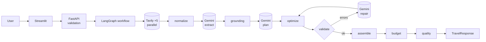

# Project Explanation — AI Travel Planner

This file explains the whole system from beginning to end, without making you open random files. It is kept
current at the end of every build stage.

**Final state (end of Stage 5):** a user fills in a trip form (Streamlit). The API researches the destination live,
uses Gemini to extract places, **verifies every place and price against its source**, has Gemini arrange only
verified places into a plan (titles, dates and prices written by code), checks and repairs the plan with code, and
computes the budget in code. Every step emits JSON logs and metrics; DeepEval scores outputs offline. The system is
packaged as Docker images, Kubernetes manifests (local and GKE overlays), a GCP deployment design and GitHub
Actions CI/CD, with rate/concurrency limits, CORS policy and a production configuration guard.

**Verified:** 300 offline tests, demo evaluation, local observability, static validation of Docker, Kubernetes and
workflow files, dependency and secret scans. **Not run:** real Gemini/Tavily calls (no keys); Docker, compose, ELK,
Kubernetes, GKE and GitHub Actions (no Docker/cluster/cloud access). Details: FINAL_PROJECT_REPORT.md.

---

## 4.1 Problem statement

Planning a trip means combining many small, changing facts (what to see, where to eat, where to stay, how to
get there, what it costs) with personal preferences (couple, vegetarian, relaxed, ₹25,000). People do this
by hand across dozens of browser tabs. Asking a chatbot is faster, but it confidently invents places and
prices, because its knowledge is frozen and it is built to sound plausible, not to be correct.

## 4.2 Proposed solution

A pipeline that splits the work between what code is good at and what an LLM is good at:

1. **Validate** the request strictly (code).
2. **Search** the live web with five fixed queries (search API).
3. **Clean and number** the results S1..Sn (code).
4. **Extract** structured places, restaurants, hotels and transport from those results, each citing its
   source (LLM call 1).
5. **Verify** each extracted item: does the cited source really mention it? Does the quoted price really
   appear there? (code)
6. **Plan**: arrange only verified places, by id, into days and time slots (LLM call 2).
7. **Optimize and validate**: fix mechanical problems, detect rule violations, send them back to the LLM
   with the exact errors at most twice (code + LLM repair).
8. **Assemble and budget**: add dates, areas and verified prices; compute every budget line in code, labelling
   each number as `source`, `estimate` or `unknown` (code).

Everything returned is traceable to a URL, and every gap is stated rather than filled with a guess.

## 4.3 Technologies

For each: what it is · why we need it · where it is used · what would happen without it.

### Python 3.11+
General-purpose language with the best AI ecosystem. Everything in `app/`, `frontend/`, `tests/`.

### FastAPI
A web framework that turns typed Python functions into HTTP endpoints and generates docs at `/docs`. Used in
`app/main.py` and `app/api/` (`/plan`, `/research`, `/health`, `/version`, `/metrics`). Without it we would
hand-write request parsing, validation and documentation.

### Pydantic / pydantic-settings
Data classes with validation. The same classes validate API input, define the JSON Gemini must return
(`ResearchExtraction`, `ItineraryDraft`) and validate what comes back, and describe the API response. Used in
`app/schemas/` and `app/config.py`. Without it: unvalidated dicts and LLM text flowing through the system.

### Tavily (and Serper)
Web search APIs for programs. **Input:** a query. **Output:** ranked results with page extracts. Used in
`app/tools/search/` behind a `SearchProvider` interface. Without live search the LLM answers from stale memory.

### Gemini
Google's LLM family (`gemini-2.5-flash`). Used for exactly three jobs: extraction (temperature 0), planning
(temperature 0.3) and repair. It never computes prices or totals. Without an LLM: no way to read arbitrary web
text or weigh soft preferences.

### LangChain (core pieces only)
`BaseChatModel` (one interface for Gemini, the demo model and test fakes), `ChatPromptTemplate` (prompts as
templates), and provider-neutral error classes. Not its agents or search wrappers.

### LangGraph
Runs the workflow as a graph of steps sharing a typed state: parallel searches (fan-out/fan-in), then
extraction, grounding, planning, and a **conditional, bounded validate → repair loop**. **Why better than one
LLM call:** a single call can't search, can't be verified step by step, can't recover from partial failures,
and can't be corrected by code feedback.

### Streamlit
Turns a Python script into a web UI (`frontend/app.py`). It calls the API over HTTP, exactly like any client.
Without it: users would need curl, or we'd need a JavaScript frontend.

### pytest + ruff
Offline tests (unit, API, integration, frontend, container configuration) run in seconds; live-API tests are
separate and opt-in.

### DeepEval (Stage 4)
An LLM-evaluation framework. **In:** a dataset of 10 fixed trip requests. **Out:** per-case, per-metric scores
with thresholds and reasons, in a JSON report. Used with 7 deterministic metrics (grounding, unsupported places,
completeness, budget, constraints, preferences, research traceability) and 4 LLM-judge metrics (Faithfulness,
coherence, preference alignment, usefulness). Without it, code tests would pass while answer quality went
unmeasured. Files: `evaluation/`; docs/17, docs/19.

### Structured logging and metrics (Stage 4)
One JSON event per important step (`search_call`, `llm_call`, `itinerary_validated`, `request_completed`…), all
sharing a `request_id`; metrics for calls, latency, tokens, repairs and budget overruns. Without them, "why was
this plan slow / wrong / expensive?" has no answer. Files: `app/observability/`; docs/18.

### ELK: Elasticsearch, Logstash, Kibana (Stage 4)
Logstash tails the JSON log file, Elasticsearch stores and indexes it, Kibana searches and charts it. Without it,
logs are scattered across containers and lost on restart. Files: `monitoring/elk/`; docs/20.

### Docker and Docker Compose (Stage 4)
Images for the API and UI (multi-stage, non-root, health-checked, no secrets); compose runs them, plus ELK with
`--profile elk`. Without them, "works on my machine" problems and no path to Kubernetes. Files: `Dockerfile`,
`frontend/Dockerfile`, `docker-compose.yml`; docs/21, docs/22.

*(Stage 5: Kubernetes, GCP, GitHub Actions. Planned roles are in `ARCHITECTURE.md`.)*

## 4.4 How one request flows

| Step | Component | Turns this… | …into this |
|---|---|---|---|
| 1 | `frontend/app.py` | form | request JSON → `POST /api/v1/plan` |
| 2 | middleware + `TravelRequest` | HTTP body | validated object + `request_id` (or 422) |
| 3 | `TravelPlanner` | settings | providers, or 503 naming missing keys (never a silent demo fallback) |
| 4 | `prepare_queries` → 5 × `search_*` | request | provider results (failures recorded per category) |
| 5 | `aggregate_research` | results | `SearchHit` S1..Sn (or `NO_RESEARCH_RESULTS` before any LLM call) |
| 6 | `extract_entities` (LLM 1) | sources | `ResearchExtraction` |
| 7 | `ground_entities` | claims | verified `ResearchResult` + `GroundingReport` |
| 8 | `generate_itinerary` (LLM 2) | verified places | `ItineraryDraft` (ids only; no prices or dates) |
| 9 | `optimize` → `validate` (→ `repair`, LLM 3, ≤ 2×) | draft | rule-abiding draft, or `ITINERARY_INVALID` |
| 10 | `assemble` → `budget` → `quality` | draft | `Itinerary`, `BudgetBreakdown`, `QualityReport` |
| 11 | API → UI | state | `TravelResponse` rendered as schedule, budget, places & sources, quality |

Full JSON at every step: [`docs/11_request_to_research_flow.md`](docs/11_request_to_research_flow.md) and
[`docs/REQUEST_FLOW.md`](docs/REQUEST_FLOW.md).

## 4.5 How hallucinations are reduced

Live sources in the prompt → numbered citations → strict JSON schemas → **code checks every cited name and
quoted price against its source** → the planner can only reference verified ids (or explicit generic activities),
has no field for prices or titles, and its free text is checked for unverified place names →
prices attached by code from verified quotes → plan validated and repaired by code feedback → budget computed in
code with labelled defaults → gaps reported → sources shown to the user. Known gaps are listed in
[`docs/10_hallucination_control.md`](docs/10_hallucination_control.md).

## 4.6 Failure behaviour

| Failure | User gets |
|---|---|
| Missing key | 503 `CONFIGURATION_ERROR` + names of the missing variables |
| One search category fails | 200 with `status: "partial"` and a warning |
| All searches fail | the real cause: 504 `SEARCH_TIMEOUT`, 502 `SEARCH_PROVIDER_AUTH_ERROR`, 429 … |
| Nothing (or no attractions/restaurants) verified | 422 `NO_RESEARCH_RESULTS`, before the planner runs |
| Gemini slow / rate-limited / auth | 504 `LLM_TIMEOUT` / 429 / 502 `LLM_AUTH_ERROR` |
| Gemini returns bad JSON twice | 502 `LLM_INVALID_OUTPUT` |
| Plan still breaks rules after 2 repairs | 502 `ITINERARY_INVALID` + the error codes |
| Over budget / unknown costs | 200 with `OVER_BUDGET` / `BUDGET_INCOMPLETE` warnings |

Secrets, provider messages and stack traces are never included in responses.

## 4.7 Demo mode

`DEMO_MODE=true` runs the full pipeline offline with **invented** data (names start with "Sample", URLs use the
reserved `.invalid` domain, every response says `data_mode: "demo"` and the UI shows a yellow DEMO banner). The
demo model deliberately plants one fake attraction (rejected by grounding) and one bad place id (fixed by one
repair round), so you can watch both controls work. It is never used automatically.

## 4.8 Deployment (Stage 5)

### Kubernetes
Runs the images as Deployments: API 2–6 replicas (HPA), UI 1 replica; ClusterIP Services; Ingress for the UI only;
liveness `/health`, readiness `/health/ready`; read-only non-root pods; default-deny NetworkPolicy.
`infrastructure/kubernetes/`, docs/23.

### GCP
GKE Autopilot runs it; Artifact Registry stores images; Secret Manager holds keys, mounted as files via Workload
Identity (no key files); Cloud Logging collects stdout JSON (ELK stays local). docs/24.

### GitHub Actions
CI on every PR (lint, tests, demo evaluation, pip-audit, manifest validation); images, smoke test and Trivy on main;
deploy after CI; live evaluation on demand. docs/26.

## 4.9 What would come next
Run the real system and measure latency and cost; run the containers and cluster; authentication; research caching;
tracing. See FINAL_PROJECT_REPORT.md → Future improvements.
