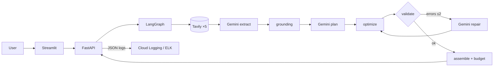
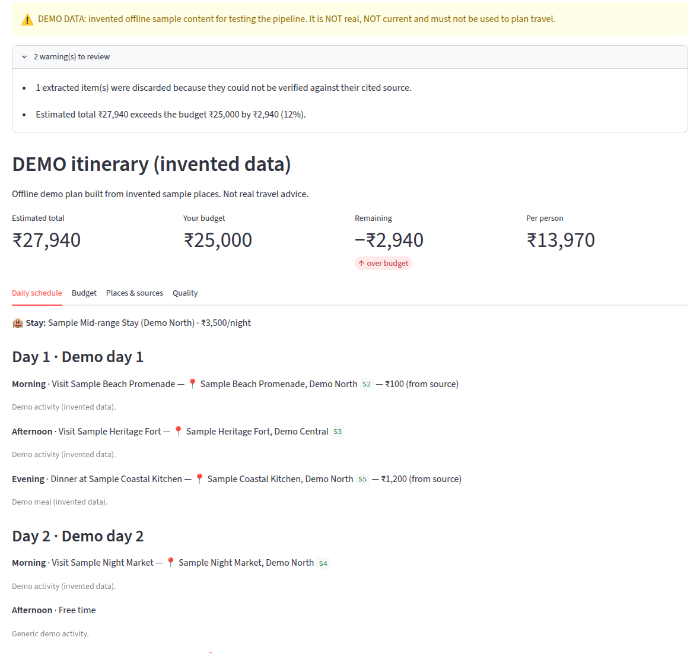
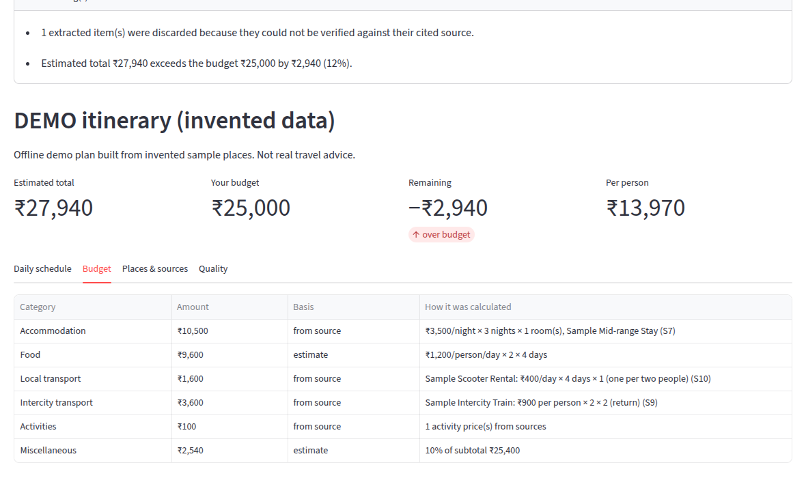

# AI Travel Planner — a grounded LLM itinerary service with an LLMOps toolchain

Plans multi-day trips from **live web research**, uses **Gemini** only where judgement is needed, and verifies
every place and price against its source. FastAPI · LangGraph · Gemini · Tavily · Streamlit · DeepEval · JSON
observability · Docker · ELK · Kubernetes · GKE · GitHub Actions.

## Status (no result in this repository is fabricated)

| Area | Status |
|---|---|
| Application, grounding, validation/repair, budget, UI | **VERIFIED** by 300 offline tests (faked providers) and demo mode; UI checked in a headless browser |
| Real Gemini + Tavily calls | **NOT RUN**: no API keys were available. Live tests and live evaluation are ready (`tests/live`, `eval-live.yml`) |
| DeepEval | **DEMO ONLY**: 8/10 cases pass all metrics on invented data; LLM judge NOT RUN |
| Structured logs and metrics | **VERIFIED** locally |
| Docker / docker-compose / ELK | **NOT RUN**: Docker unavailable; hadolint clean, configuration tests pass |
| Kubernetes | **NOT RUN** on a cluster; manifests valid (kubeconform strict, 31/31) and tested for consistency |
| GCP (GKE, Artifact Registry, Secret Manager, Workload Identity) | **DOCUMENTED ONLY** |
| CI/CD (GitHub Actions) | **NOT RUN** on GitHub; actionlint clean, inputs verified |
| Security scans | pip-audit: no known vulnerabilities · gitleaks: 0 project findings · Trivy: NOT RUN (needs images) |

Full details: [FINAL_PROJECT_REPORT.md](FINAL_PROJECT_REPORT.md).

## Why this project
A chatbot asked to "plan 4 days in Goa for ₹25,000" invents places and prices confidently. This project shows the
engineering needed to make an LLM application trustworthy and operable: retrieval, structured output, deterministic
verification, bounded self-repair, evaluation, observability and deployment, each with a stated reason.

## Features
- 5 parallel live searches → Gemini extraction → **grounding** (names and quoted prices must appear in the cited source)
- Planner may use **only verified place ids** (or explicit generic activities); titles, dates and prices are written by code
- Deterministic optimizer + validator (incl. unverified-place-name check) + **bounded repair loop**
- **Deterministic budget** with per-line working, `source` / `estimate` / `unknown` labels
- Streamlit UI with demo banner, warnings, sources, quality tab
- Offline **demo mode**, never used silently
- **DeepEval** suite: 10 cases, 7 code metrics + 4 LLM-judge metrics, JSON reports
- **JSON logs** for every search, LLM call, validation and repair, correlated by `request_id`; metrics endpoint
- Rate and concurrency limits, CORS policy, production configuration guard, file-based secrets
- Docker, compose + ELK, Kubernetes (Kustomize), GKE guide, CI/CD with scans and gated deploys

## Architecture

Cloud and local diagrams: [ARCHITECTURE.md](ARCHITECTURE.md) §0 · request trace: [docs/FINAL_REQUEST_FLOW.md](docs/FINAL_REQUEST_FLOW.md).

## Screenshots (real, demo mode)
| Itinerary | Budget |
|---|---|
|  |  |

## Folder structure
```text
app/            FastAPI app: api/ schemas/ services/ graph/ research/ tools/search/ llm/ prompts/ planning/ observability/
frontend/       Streamlit UI (+ Dockerfile)
evaluation/     DeepEval dataset, metrics, judge, runner
tests/          unit/ api/ integration/ frontend/ live/
monitoring/elk/ Logstash pipeline, ES template, Kibana setup
infrastructure/kubernetes/  base/ + overlays/{local,gke}
.github/workflows/          ci.yml, deploy.yml, eval-live.yml
docs/           numbered chapters 03–26 + guides
```
File-by-file: [docs/FILE_GUIDE.md](docs/FILE_GUIDE.md).

## Quick start (local, demo mode, no keys)
```bash
python3 -m venv .venv && .venv/bin/pip install -r requirements-dev.txt
cp .env.example .env && sed -i 's/^DEMO_MODE=false/DEMO_MODE=true/' .env
.venv/bin/uvicorn app.main:app --reload          # http://localhost:8000/docs
.venv/bin/streamlit run frontend/app.py          # http://localhost:8501
```

## Real APIs
Set `DEMO_MODE=false`, `GEMINI_API_KEY` (https://aistudio.google.com/apikey) and `TAVILY_API_KEY`
(https://app.tavily.com) in `.env`; restart. Smoke test: `RUN_LIVE_TESTS=1 .venv/bin/pytest tests/live -v`.

## Docker and ELK
```bash
docker compose up --build                        # API :8000 + UI :8501 (localhost only)
docker compose --profile elk up --build          # + Elasticsearch :9200, Logstash, Kibana :5601 (~3 GB RAM)
```
[docs/21](docs/21_docker.md) · [docs/22](docs/22_docker_compose.md) · [docs/20](docs/20_elk_stack.md)

## Kubernetes and GCP
```bash
kubectl apply -k infrastructure/kubernetes/overlays/local                      # kind/minikube, demo mode
kubectl -n travel-planner port-forward svc/frontend 8501:8501
```
GKE Autopilot + Artifact Registry + Secret Manager + Workload Identity: [docs/23](docs/23_kubernetes.md),
[docs/24](docs/24_gcp.md).

## CI/CD
PRs: ruff, tests, demo evaluation, pip-audit, kubeconform. Main: image builds, smoke test, Trivy. Deploy to GKE
after CI (Workload Identity Federation, rollback on failure). Live evaluation: manual. [docs/26](docs/26_cicd.md).

## Testing and evaluation
```bash
.venv/bin/pytest -q                                            # 300 offline tests
.venv/bin/ruff check . && .venv/bin/ruff format --check .
.venv/bin/pip install -r requirements-eval.txt
.venv/bin/python -m evaluation.runner --mode demo              # pipeline mechanics (invented data)
.venv/bin/python -m evaluation.runner --mode live --judge      # real system (keys, costs credits)
```

## Observability and security
JSON events (`search_call`, `llm_call`, `itinerary_validated`, `plan_completed`, `request_completed`…) with
`request_id` and `severity`; `/api/v1/metrics`. [docs/18](docs/18_observability.md) · security review: [docs/25](docs/25_security.md).

## API example
```bash
curl -s -X POST localhost:8000/api/v1/plan -H 'Content-Type: application/json' -d '{
  "destination": "Goa", "origin_city": "Bengaluru", "num_days": 4, "budget": 25000, "num_travelers": 2,
  "preferences": {"travel_style": "couple", "interests": ["beaches", "food", "nightlife"], "transport": ["train"]}}'
```
Response (abridged, real demo output):
```json
{"stage": "itinerary", "status": "success", "data_mode": "demo",
 "itinerary": {"days": [{"day_number": 1, "activities": [
    {"slot": "morning", "title": "Visit Sample Beach Promenade", "place_id": "A1", "estimated_cost": 100.0, "cost_basis": "source"}]}]},
 "budget": {"total": 27940.0, "within_budget": false, "complete": true},
 "quality": {"repair_attempts": 1, "issues": [{"code": "OVER_BUDGET", "severity": "warning"}]},
 "metadata": {"llm_calls": 3, "is_demo": true}}
```
Endpoints: `POST /api/v1/plan`, `POST /api/v1/research`, `GET /api/v1/health`, `/health/ready`, `/version`, `/metrics`.

## Documentation
Start: [PROJECT_EXPLANATION.md](PROJECT_EXPLANATION.md) → [docs/FINAL_BEGINNER_GUIDE.md](docs/FINAL_BEGINNER_GUIDE.md) →
chapters [03](docs/03_configuration.md)–[26](docs/26_cicd.md). Interviews: [INTERVIEW_GUIDE.md](INTERVIEW_GUIDE.md),
[docs/FIVE_MINUTE_PROJECT_EXPLANATION.md](docs/FIVE_MINUTE_PROJECT_EXPLANATION.md), [docs/RESUME_PROJECT.md](docs/RESUME_PROJECT.md).
Problems: [TROUBLESHOOTING.md](TROUBLESHOOTING.md). Contributing: [CONTRIBUTING.md](CONTRIBUTING.md).

## Future improvements
Run against real APIs and record latency and cost · run Docker, kind and CI for real · authentication + Cloud
Armor · research caching · targeted repair · OpenTelemetry tracing · autoscaling on in-flight requests ·
human-rated evaluation set.

## License
MIT, see [LICENSE](LICENSE).
