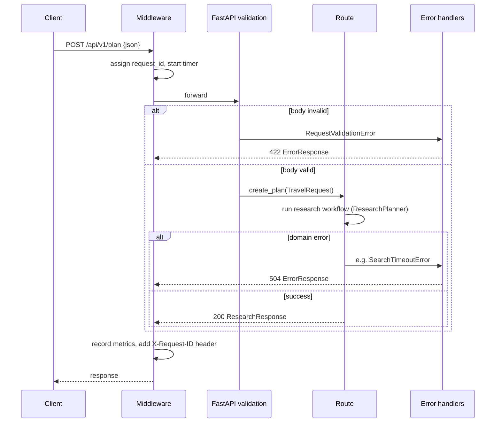

# 05 — The FastAPI backend (Phase 5, updated in Stage 2)

Files: [`app/main.py`](../app/main.py), [`app/api/routes.py`](../app/api/routes.py),
[`app/api/middleware.py`](../app/api/middleware.py), [`app/api/errors.py`](../app/api/errors.py),
[`app/core/exceptions.py`](../app/core/exceptions.py), [`app/observability/metrics.py`](../app/observability/metrics.py)

## Concepts first

- **Web application**: a program that waits for requests over the network and sends back responses.
- **API (Application Programming Interface)**: a web application meant for *programs*, not people. Our
  Streamlit UI, DeepEval scripts and `curl` are all clients of the same API.
- **HTTP request**: a *method* (`GET` = read, `POST` = submit), a *URL path* (`/api/v1/plan`), *headers*
  (metadata such as `Content-Type: application/json`) and optionally a *body*.
- **HTTP status code**: a number summarising the outcome: 2xx success, 4xx the client's fault (bad input,
  rate limited), 5xx the server's or an upstream service's fault.
- **JSON**: the text format for the bodies, e.g. `{"destination": "Goa", "num_days": 4}`.
- **FastAPI**: a Python framework that turns type-annotated functions into HTTP endpoints, validates
  bodies with Pydantic and generates interactive docs at `/docs`.

## WHAT

A small HTTP service with two business endpoints (`POST /api/v1/plan`, `POST /api/v1/research`) and three operational ones
(`health`, `version`, `metrics`), plus middleware and error handling shared by all of them.

## WHY these pieces

| Piece | Why it exists |
|---|---|
| `create_app()` factory | Tests build a fresh app; all wiring is visible in one function |
| `/api/v1` prefix | Lets us ship `/api/v2` later without breaking existing clients |
| Thin routes | Business logic in services/graph can be reused without HTTP |
| Request-id middleware | Trace one user's request across many log lines and pods |
| Central error handlers | Every error has the same JSON shape; secrets/tracebacks never leak |
| Domain exceptions (`core/exceptions.py`) | Inner code says *what* went wrong (`SearchTimeoutError`); the API layer decides *how* to report it (504) |

## Request lifecycle



## Endpoints

### `POST /api/v1/plan`

| | |
|---|---|
| Purpose | Generate an itinerary |
| Request | `TravelRequest` JSON (see `docs/12_data_models.md`) |
| Response 200 | `TravelResponse`: itinerary, budget, verified research, sources, grounding, warnings, quality, metadata (`stage: "itinerary"`) |
| Validation | Automatic from `TravelRequest`: ranges, enums, place-name characters, date consistency, no unknown fields |
| Errors | 422 `INVALID_REQUEST` / `NO_RESEARCH_RESULTS`, 429 `RATE_LIMITED`, 502 `SEARCH_PROVIDER_ERROR` / `SEARCH_PROVIDER_AUTH_ERROR` / `LLM_ERROR` / `LLM_AUTH_ERROR` / `LLM_INVALID_OUTPUT` / `ITINERARY_INVALID`, 503 `CONFIGURATION_ERROR`, 504 `SEARCH_TIMEOUT` / `LLM_TIMEOUT`, 500 `INTERNAL_ERROR` |
| Calls | `get_planner()` → `TravelPlanner.run()` → LangGraph planning workflow (see `docs/13_itinerary_planning.md`) |

### `POST /api/v1/research`

Same request and errors as `/plan` (except `ITINERARY_INVALID`). Runs only the research half and returns
`ResearchResponse` (`stage: "research"`: search summary, normalized results, verified entities, grounding
report). Use it to inspect research quality on its own. Calls `get_research_planner()` → `ResearchPlanner.run()`.

### `GET /api/v1/health` (liveness)

Returns `{"status": "ok", "checks": {"process": "ok"}}`. Checks **nothing external** on purpose: if
Gemini is down, restarting our container won't fix it, and a liveness probe that depended on Gemini would make
Kubernetes restart healthy pods in a loop.

### `GET /api/v1/health/ready` (readiness)

200 if the configured providers have their keys; otherwise **503** with
`{"status": "degraded", "checks": {"config": "missing: GEMINI_API_KEY, TAVILY_API_KEY"}}`. Only variable
**names** are reported. Kubernetes stops routing traffic to a pod that is not ready.

### `GET /api/v1/version`

Name, version, `git_sha` (set by CI at build time), environment, LLM provider/model, search provider. It
answers "what exactly is running in production?" during an incident.

### `GET /api/v1/metrics`

In-process counters and timings, e.g.

```json
{
  "uptime_seconds": 1.0,
  "counters": {"http_requests_total{method=POST,route=/api/v1/plan,status=422}": 1},
  "timings_ms": {"http_request_latency{method=GET,route=/api/v1/health}": {"count": 2, "avg": 3.32, "max": 6.12}}
}
```

Per-process only, reset on restart. The durable, cross-pod view comes from JSON logs in ELK (docs/18, docs/20). Routes are
recorded by **template** (`/api/v1/plan`), never by raw path, so the number of metric keys stays bounded.

## Error format (every non-2xx response)

```json
{
  "error": {
    "code": "INVALID_REQUEST",
    "message": "The request body failed validation.",
    "request_id": "58c627712c3d4074bf93d4e1ec611320",
    "details": {"fields": [
      {"field": "num_days", "message": "Input should be less than or equal to 14"},
      {"field": "budget", "message": "Input should be greater than 0"}
    ]}
  }
}
```

Clients branch on `code` (stable) rather than `message` (wording may change). Unexpected exceptions become
a generic `INTERNAL_ERROR`; the test `test_unexpected_errors_do_not_leak_details` makes sure an exception message
containing `password=hunter2` never reaches the client.

## Run it

```bash
cd ~/ai-travel-planner
python3 -m venv .venv && .venv/bin/pip install -r requirements-dev.txt
.venv/bin/uvicorn app.main:app --reload          # http://localhost:8000/docs
.venv/bin/pytest -q                              # no keys needed (live tests are skipped)
```

Try it:

```bash
curl -s localhost:8000/api/v1/health
curl -s -X POST localhost:8000/api/v1/plan -H 'Content-Type: application/json' \
  -d '{"destination":"Goa","num_days":4,"budget":25000,"num_travelers":2}'
# without keys and without DEMO_MODE=true → 503 CONFIGURATION_ERROR naming the missing variables
# with DEMO_MODE=true → 200, research clearly labelled DEMO
# with real keys      → 200, live research
```

## BEGINNER EXPLANATION

The API is a restaurant counter. The middleware is the person who gives every order a ticket number
(`request_id`) and notes how long it took. FastAPI's validation checks the order form. The route passes the
order to the kitchen (the research planner). If anything goes wrong, the error handlers make sure the customer
gets a polite, standard note with the ticket number, never the chef's private notes.

## Common mistakes

- Putting business logic in route functions: it then can't be tested or reused without HTTP.
- Returning raw exception text to the client: it leaks internals.
- Making liveness depend on external services: this causes restart loops in Kubernetes.
- Forgetting `Content-Type: application/json` with curl: FastAPI then can't parse the body.
