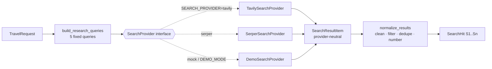

# 07 — The search layer (Phases 2.1–2.4)

Files: [`app/tools/search/`](../app/tools/search/) (`base.py`, `tavily.py`, `serper.py`, `demo.py`, `factory.py`),
[`app/research/queries.py`](../app/research/queries.py), [`app/research/normalizer.py`](../app/research/normalizer.py),
[`app/research/text.py`](../app/research/text.py)



---

## 2.1 The search abstraction

### WHAT
An abstract class, `SearchProvider`, with one method:

```python
class SearchProvider(ABC):
    name: ClassVar[str]
    is_demo: ClassVar[bool] = False

    @abstractmethod
    async def search(self, query: ResearchQuery, *, max_results: int) -> list[SearchResultItem]: ...
```

### WHY
- The workflow (`app/graph/research_graph.py`) imports only `SearchProvider`, never Tavily. Replacing Tavily
  is a config change (`SEARCH_PROVIDER=serper`), and adding Bing/Brave means one new class plus one line in
  `factory.py`.
- Tests pass a `FakeSearchProvider` with canned results, so no test needs the internet.
- Every provider promises the same error behaviour, so the workflow handles failures in one place.

### INPUT → OUTPUT
`ResearchQuery(category, destination, text)` and `max_results` → `list[SearchResultItem(title, url, content, score)]`.
Errors are always one of our domain exceptions (see the table below).

### CONNECTION
`factory.create_search_provider(settings)` picks the class; `ResearchPlanner` passes it into the graph; each
`search_<category>` node calls `provider.search(...)`.

### BEGINNER EXPLANATION
A wall socket. Your laptop (the workflow) doesn't care which power station (Tavily, Serper) produces the
electricity, as long as the socket shape is the same.

---

## 2.2 Tavily integration

### WHAT
`TavilySearchProvider` POSTs to `https://api.tavily.com/search` with the query, `max_results`,
`search_depth` and `include_answer: false` (we want sources, not Tavily's own AI summary). Auth is
`Authorization: Bearer <TAVILY_API_KEY>`.

### Error handling (shared in `HttpSearchProvider._post_json`)

| What happened | Exception | HTTP status our API returns |
|---|---|---|
| `httpx.TimeoutException` | `SearchTimeoutError` | 504 `SEARCH_TIMEOUT` |
| DNS/connection failure | `SearchProviderError` | 502 |
| 401 / 403 | `SearchAuthError` | 502 `SEARCH_PROVIDER_AUTH_ERROR` |
| 429 | `RateLimitError` (`upstream: true`) | 429 |
| other ≥ 400 | `SearchProviderError` (`upstream_status`) | 502 |
| body not JSON / no `results` key | `SearchProviderError` (`reason`) | 502 |
| `results: []` | *not an error*: an empty list | (handled by the workflow) |

The key lives in a `SecretStr`, is read with `.get_secret_value()` only to build the header, and headers are
never logged or attached to errors. Tests check that a key appearing in an upstream error body never ends up
in our exception.

Those statuses apply when **every** category fails. If only some fail, the request continues as `partial`
(see `docs/09_research_pipeline.md`).

### Why no automatic fallback to demo data
If the Tavily key is missing, `create_search_provider` raises `ConfigurationError` → 503 with
`details.missing = ["TAVILY_API_KEY"]`. Silently swapping real research for invented samples would look
like resilience but would actually be a correctness bug.

### Serper
`SerperSearchProvider` (Google results via serper.dev, header `X-API-KEY`) exists to prove the abstraction
works. Its snippets are short, so expect fewer extracted entities than with Tavily.

---

## 2.3 Deterministic research queries

### WHAT
`build_research_queries(request)` returns exactly five `ResearchQuery` objects, one per `ResearchCategory`,
always in the same order: destination, attractions, restaurants, hotels, transportation.

### WHY a fixed plan instead of an autonomous agent
- Every trip needs all five kinds of information, so there is nothing for an LLM to decide.
- An agent that "decides" it already knows the hotels is exactly how invented hotels get in.
- Fixed cost and latency: always 5 searches, run in parallel.
- Reproducible: the same request gives the same queries, which is easy to test and debug.

### LOGIC (Goa example, real output of the function)

| Category | Built from | Query |
|---|---|---|
| destination | destination | `Goa travel guide best time to visit local tips` |
| attractions | destination, style, interests | `top things to do in Goa for couple travellers interested in beaches, food, nightlife` |
| restaurants | destination, dietary | `best restaurants in Goa with prices` |
| hotels | destination, accommodation | `best mid-range hotels in Goa price per night` |
| transportation | origin, destination, transport | `how to travel from Bengaluru to Goa by train and getting around locally` |

Only validated fields are used. `special_requirements` (free text) is deliberately **not** put into searches;
a test checks this.

---

## 2.4 Normalization

### WHY
Providers name fields differently; the same page often appears for two queries; web text contains control
characters, huge pages, unrelated pages, `javascript:` links, and text that imitates our prompt markup. The
LLM and the grounding checks need one clean, predictable, citable shape.

### LOGIC (`normalize_results`, in order, per result)
1. drop non-http(s) URLs
2. clean text; remove anything resembling `<source ...>` / `</source>` so a page can't "close" its block in the prompt
3. drop content shorter than 40 characters
4. **relevance filter**: drop results that never mention the destination as a whole word ("goal" ≠ "Goa")
5. drop duplicate URLs (case, trailing slash, `#fragment` and `utm_*` ignored; the first category wins)
6. truncate at a word boundary to `SEARCH_MAX_CONTENT_CHARS`
7. assign `S1..Sn` and record `domain`, `category`, `query`, `provider`, `retrieved_at`

### EXAMPLE: raw Tavily → normalized

> Hand-written in Tavily's documented response format (`tests/fakes.py`), **not** a recorded API response.
> The normalized output below is the *real* output of our code for that input.

Raw (provider JSON):
```json
{
  "query": "top things to do in Goa for couple travellers interested in beaches, food, nightlife",
  "results": [
    {
      "title": "15 Best Things to Do in Goa",
      "url": "https://www.example-travel.com/goa/things-to-do?utm_source=x",
      "content": "Baga Beach in North Goa is known for water sports and nightlife along Tito's Lane. Fort Aguada, a 17th-century Portuguese fort near Candolim, offers sea views. Entry fee: ₹50 per person.",
      "score": 0.91,
      "raw_content": null
    },
    { "title": "Goa beaches guide", "url": "https://blog.example.org/goa-beaches",
      "content": "Palolem Beach in South Goa is a calm crescent bay, popular with couples.", "score": 0.84 }
  ],
  "response_time": 1.2
}
```

Normalized (`SearchHit`):
```json
{
  "source_id": "S1",
  "category": "attractions",
  "query": "top things to do in Goa for couple travellers interested in beaches, food, nightlife",
  "title": "15 Best Things to Do in Goa",
  "url": "https://www.example-travel.com/goa/things-to-do?utm_source=x",
  "domain": "example-travel.com",
  "content": "Baga Beach in North Goa is known for water sports and nightlife along Tito's Lane. Fort Aguada, a 17th-century Portuguese fort near Candolim, offers sea views. Entry fee: ₹50 per person.",
  "score": 0.91,
  "provider": "tavily",
  "retrieved_at": "2026-10-01T09:30:00Z"
}
```

What changed: a provider-independent shape; a stable citable id; `domain` extracted; the `category` and
`query` that found it are recorded; Tavily-only fields (`raw_content`, `response_time`) dropped. The URL is
kept exactly as given (for the user); a canonical form is used only to detect duplicates.

### BEGINNER EXPLANATION
Normalization is a librarian who receives books from five different shops: removes the ones that are
damaged or about the wrong city, throws away second copies, cuts very long ones down, and puts a numbered
label (S1, S2, ...) on each spine so everyone can refer to them precisely.

## Common mistakes
- Letting provider-specific JSON leak into the rest of the code (then switching provider breaks everything).
- Treating "no results" as an error (it's valid; the *workflow* decides what to do).
- Logging request headers (that is where the API key is).
- Substring relevance checks ("goal" matching "Goa").
