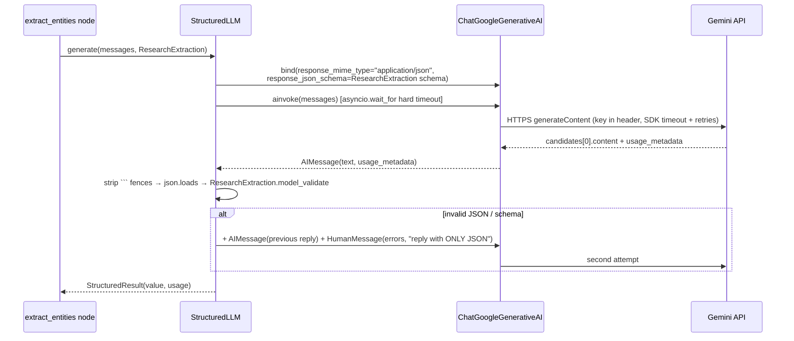

# 08 — Gemini integration (Phase 2.5)

Files: [`app/llm/factory.py`](../app/llm/factory.py), [`app/llm/client.py`](../app/llm/client.py),
[`app/llm/demo_model.py`](../app/llm/demo_model.py), [`app/config.py`](../app/config.py)

## WHAT
- **Gemini** is Google's family of LLMs, available through the Gemini API (Google AI Studio keys) or Vertex AI
  (GCP). We use `gemini-2.5-flash`: fast, inexpensive, good at JSON. The model name lives in one setting,
  `LLM_MODEL`.
- **The API** receives a list of *contents* (our messages), a *system instruction*, and a *generation config*
  (temperature, response MIME type, response schema), and returns *candidates* (the reply), plus *usage
  metadata* (token counts).
- We call it through **LangChain's `ChatGoogleGenerativeAI`** (`langchain-google-genai` 4.4.0), which converts
  LangChain messages to Gemini's format and Gemini's errors into provider-neutral LangChain exceptions.

## WHY through LangChain (and only the parts we use)
- One `BaseChatModel` interface: the same `StructuredLLM` works with Gemini, the offline demo model and test
  fakes. Changing vendor = one new branch in `factory.py`.
- `ChatPromptTemplate` for the prompt (see `docs/09_research_pipeline.md`).
- Error classes like `ModelRateLimitError` and `ModelAuthenticationError` that don't depend on the vendor.

We do **not** use `with_structured_output()`. In this library version it binds the same two Gemini parameters
we bind ourselves, but it would hide the parsing step that we want to control: our own error types, a bounded
retry with feedback, and token accounting across retries.

## Request → response, step by step

## Configuration (all in `app/config.py`, read from `.env`)

| Variable | Default | Purpose |
|---|---|---|
| `LLM_PROVIDER` | `gemini` | `gemini` or `fake` (demo; only with `SEARCH_PROVIDER=mock`) |
| `LLM_MODEL` | `gemini-2.5-flash` | the only place the model name is written |
| `GEMINI_API_KEY` | none | the key (old name `LLM_API_KEY` also accepted) |
| `RESEARCH_TEMPERATURE` | `0.0` | extraction copies facts, so no creativity |
| `LLM_TIMEOUT_SECONDS` | `60` | per-attempt SDK timeout |
| `LLM_MAX_RETRIES` | `2` | SDK retries for transient network/5xx errors |
| `LLM_OUTPUT_RETRIES` | `1` | our re-ask when the JSON is invalid |

**Two different retry kinds:** `LLM_MAX_RETRIES` handles *the call failed* (network, 5xx) inside the Google
SDK. `LLM_OUTPUT_RETRIES` handles *the call succeeded but the answer is unusable*, in our code, by showing
the model its validation errors. Both are bounded, so cost is bounded.

**Timeouts:** the SDK timeout applies per attempt; `StructuredLLM` also wraps every call in
`asyncio.wait_for(timeout × (retries+1) + 5s)` so a hung connection can never hold a request forever.

## Error handling

| Raised by LangChain/SDK | Becomes | API status / code |
|---|---|---|
| `ModelTimeoutError`, `asyncio` timeout, `httpx.TimeoutException` | `LLMTimeoutError` | 504 `LLM_TIMEOUT` |
| `ModelRateLimitError` (HTTP 429) | `RateLimitError` | 429 `RATE_LIMITED` |
| `ModelAuthenticationError`, `ModelPermissionDeniedError` (401/403) | `LLMAuthError` | 502 `LLM_AUTH_ERROR` |
| `ModelNotFoundError` (bad `LLM_MODEL`) | `ConfigurationError` | 503 |
| `ContextOverflowError` | `LLMError` | 502 |
| anything else | `LLMError` | 502 `LLM_ERROR` |
| invalid JSON / schema after retries | `LLMOutputError` | 502 `LLM_INVALID_OUTPUT` |
| key missing | `ConfigurationError` (`missing: ["GEMINI_API_KEY"]`) | 503 |

Provider error messages are logged as *exception types*, never returned to the client. A test puts a fake key
inside a provider exception and checks it does not appear in our error.

## API key management
- Locally: `.env` (git-ignored) → `Settings.llm_api_key: SecretStr`.
- Passed to `ChatGoogleGenerativeAI(google_api_key=SecretStr)`, which stays masked in `repr` (tested).
- In Kubernetes: a Kubernetes Secret locally; on GKE, Secret Manager mounted as files read via `SECRETS_DIR` (docs/24). Same name,
  `GEMINI_API_KEY` env var. The code doesn't change.
- If a key leaks: revoke it in AI Studio, create a new one, update the secret. Never "just delete the commit";
  it's already been copied.

## EXAMPLE: what actually goes over the wire
Checked offline (no network) by `test_gemini_request_carries_json_mode_and_schema`: the request config has
`response_mime_type = "application/json"`, `response_json_schema.title = "ResearchExtraction"`,
`temperature = 0.0`, and the system message becomes Gemini's `system_instruction`.

> **NOT TESTED: API KEY REQUIRED.** No real Gemini call has been made while building this stage, so
> whether Gemini accepts every feature of our JSON Schema (e.g. `additionalProperties: false`) has not been
> verified against the live API. Run `RUN_LIVE_TESTS=1 .venv/bin/pytest tests/live -v` with keys to check.
> If Gemini rejects part of the schema, the fallback is to construct `StructuredLLM(...,
> native_json_schema=False)`: JSON is then requested only by the prompt, and Pydantic validation plus the retry
> still apply.

## Demo model
`DemoChatModel` is a LangChain chat model that needs no key. It parses the demo `<source>` blocks in the
prompt and returns extraction JSON, so demo mode exercises the same prompt → parse → validate → ground path.
It is a deterministic parser, not an AI, and it plants one invented attraction ("Imaginary Palace") so you can
see grounding reject it.

## BEGINNER EXPLANATION
`factory.py` decides *which brain* to use. `client.py` is the careful secretary between us and that brain: it
hands over the question with a strict answer form, waits at most N seconds, checks the form was filled in
correctly, sends it back once with notes if not, and translates any "the brain is busy/unavailable" message
into our standard error.
