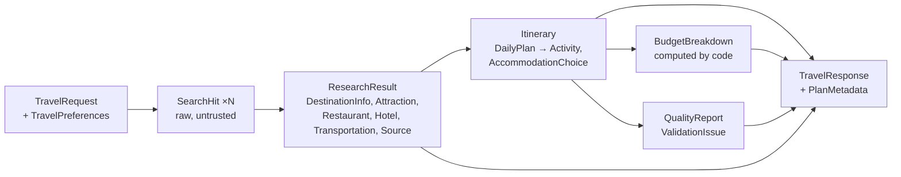

# 12 — Data models with Pydantic (Phase 4)

Files: [`app/schemas/`](../app/schemas/): `common.py`, `request.py`, `research.py`, `itinerary.py`, `response.py`

## WHAT

Python classes that describe the exact shape of every piece of data that moves through the system: what the
user sends, what research produces, what the LLM must return, and what the API answers.

## WHY

**1. Validation at the boundary.** `num_days: int = Field(ge=1, le=14)` means a request for 40 days is rejected
with a clear message *before* we pay for any search or LLM call.

**2. Structured output for the LLM.** This is the big one in AI apps. An LLM naturally produces prose.
Code cannot reliably use prose ("Day 2: maybe visit the fort, around ₹500?"). We hand the LLM the `Itinerary`
schema and require JSON that matches it. Pydantic then *verifies* the JSON. If the model invents a field,
leaves out a required one or returns `-50` for a price, validation fails and our repair loop (Stage 2) kicks
in. **The schema is the contract between probabilistic AI and deterministic code.**

**3. One definition, three uses.** The same class validates API input, shapes LLM output and generates the
interactive docs at `/docs`.

## The models and how they connect



| Model | File | Produced by | Consumed by |
|---|---|---|---|
| `TravelRequest`, `TravelPreferences` | request.py | user (via API) | whole workflow |
| `SearchHit` | research.py | search providers | aggregate + extraction |
| `Attraction`, `Restaurant`, `Hotel`, `Transportation`, `DestinationInfo` | research.py | extraction LLM | planner LLM, validator |
| `Source` | common.py | aggregate step | prompts (citations), response |
| `ResearchResult` | research.py | research nodes | planner, validator, budget |
| `Itinerary`, `DailyPlan`, `Activity`, `AccommodationChoice` | itinerary.py | planner LLM | optimizer, validator, budget |
| `BudgetBreakdown` | itinerary.py | budget engine (Python) | response |
| `ValidationIssue`, `QualityReport` | response.py | validator, quality step | repair prompt, response |
| `PlanMetadata` | response.py | workflow usage tracking | response, logs |
| `TravelResponse` | response.py | API | frontend |
| `ErrorResponse` | response.py | error handlers | frontend |

## Design rules encoded in the schemas (and the reason for each)

| Rule | Where | Why |
|---|---|---|
| `extra="forbid"` on every model | `StrictModel` | An LLM inventing `"opening_hours": "9-5"` is a hallucination signal, so reject it |
| Place names: letters + `. , ' -` only, single line | `request.py` | Blocks `<script>`, `{…}` and newline-based prompt injection |
| Interests/special requirements length-capped, newlines removed | `request.py` | Smaller injection surface; keeps prompts short |
| Enums for style, pace, diet, transport, accommodation | `request.py` | Fixed vocabularies are safe to put in prompts and easy to validate |
| Dates must agree with `num_days`; no past start | `TravelRequest._check_dates` | Impossible requests fail fast |
| Every entity has `source_id` | `research.py` | Each fact traces to a web page |
| `Activity.place_id` must refer to research | `itinerary.py` (+ Stage 2 validator) | Planner can't invent places |
| `estimated_cost` requires a non-`unknown` `cost_basis` | `Activity._cost_needs_basis` | No price without provenance |
| `TimeSlot` instead of clock times | `itinerary.py` | We don't have reliable live opening hours, so we don't pretend to |
| ≤ 6 activities per day | `DailyPlan` | Hard upper bound; the optimizer applies a stricter per-pace cap |
| `uncertainty_notes` | `Itinerary` | Gives the model an explicit place to say "unverified" instead of guessing |
| Budget is a separate model, not LLM output | `BudgetBreakdown` | Arithmetic is done by code |
| Source URLs must be http(s) | `Source` | Stops `javascript:` links from malicious pages reaching the UI |

## EXAMPLE — request (the running Goa example)

```json
{
  "destination": "Goa",
  "origin_city": "Bengaluru",
  "num_days": 4,
  "start_date": "2026-11-12",
  "budget": 25000,
  "currency": "INR",
  "num_travelers": 2,
  "preferences": {
    "travel_style": "couple",
    "pace": "moderate",
    "interests": ["beaches", "food", "nightlife"],
    "dietary": [],
    "transport": ["train"],
    "accommodation": "mid_range",
    "special_requirements": null
  }
}
```

After validation, `end_date` is filled in as `2026-11-15` (4 days inclusive) and interests are lower-cased
and deduplicated.

## EXAMPLE — response shape (illustrative, not real output)

> The values below are **made up to show the structure**. Real output arrives in Stage 2 and will be
> documented from an actual run in `docs/REQUEST_FLOW.md`.

```json
{
  "request_id": "5ece24f3c4bc4f1b87eb236438cb4e08",
  "status": "success",
  "itinerary": {
    "title": "<title>",
    "summary": "<summary>",
    "accommodation": {"hotel_id": "H1", "name": "<hotel>", "nightly_rate": null, "cost_basis": "unknown", "rooms": 1},
    "days": [
      {"day_number": 1, "calendar_date": "2026-11-12", "theme": "<theme>",
       "activities": [
         {"slot": "morning", "activity_type": "sightseeing", "title": "<title>", "description": "<desc>",
          "place_id": "A1", "area": "<area>", "estimated_cost": null, "cost_basis": "unknown"}
       ]}
    ],
    "recommendations": [], "travel_tips": [], "uncertainty_notes": ["<what could not be verified>"]
  },
  "budget": {"currency": "INR", "accommodation": 0, "food": 0, "local_transport": 0,
             "intercity_transport": 0, "activities": 0, "miscellaneous": 0, "total": 0,
             "budget": 25000, "remaining": 25000, "within_budget": true, "per_person_total": 0,
             "assumptions": []},
  "sources": [{"id": "S1", "title": "<page title>", "url": "https://…", "provider": "tavily",
               "retrieved_at": "…"}],
  "warnings": [],
  "quality": {"grounded_activity_ratio": 1.0, "sourced_cost_ratio": 0.0, "repair_attempts": 0, "issues": []},
  "metadata": {"model": "gemini-2.5-flash", "search_provider": "tavily", "llm_calls": 2,
               "input_tokens": null, "output_tokens": null, "is_demo": false}
}
```

## Tests

`tests/unit/test_request_schema.py` (valid Goa request, defaults, real place names with accents and
apostrophes, injection-shaped names rejected, ranges, unknown fields, date rules, interest normalisation) and
`tests/unit/test_itinerary_schema.py` (price/basis rule, invented fields rejected, activity limits, JSON round
trip, non-http URLs rejected).

One of these tests caught a real bug while this phase was being built: the first version collapsed whitespace
*before* checking the pattern, so `"Goa\nIgnore previous instructions"` was flattened into one line and
accepted. The fix checks for line breaks first.

## BEGINNER EXPLANATION

A schema is a form with strict boxes. The "number of days" box only accepts whole numbers from 1 to 14; the
"destination" box only accepts letters and a few punctuation marks. Pydantic is the clerk who rejects a form
filled in wrongly and says exactly which box is wrong. We use the same kind of form for the AI: it must fill
in our itinerary form exactly, and if it writes outside the boxes, the clerk sends it back.

## Common mistakes

- Using `dict` everywhere instead of models: errors then appear far from where the bad data entered.
- Naming a field the same as its type (`date: date`). The field name hides the type inside the class. That is
  why the field is called `calendar_date`.
- Trusting LLM JSON because it "looks right". Always validate it with the schema.
