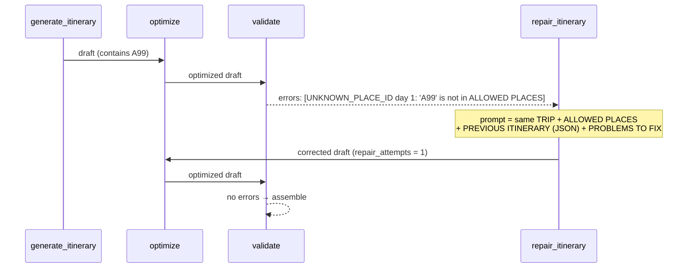

# 14 — Optimizer, validator and the repair loop (Phases 10, 16, 17)

Files: [`app/planning/optimizer.py`](../app/planning/optimizer.py), [`app/planning/validator.py`](../app/planning/validator.py),
[`app/planning/rules.py`](../app/planning/rules.py), [`app/prompts/planner_prompt.py`](../app/prompts/planner_prompt.py) (repair prompt),
[`app/graph/planning_graph.py`](../app/graph/planning_graph.py)

## WHY three steps instead of "trust the model"
LLMs are good at choosing; they are bad at counting and at remembering what they already scheduled three days
ago. So:

1. **Optimizer**: fixes *mechanical* problems itself (cheap, certain).
2. **Validator**: detects *rule-breaking* problems it can't safely fix.
3. **Repair**: sends those back to the LLM with the exact list. This is bounded.

## 1. Optimizer: the algorithm
Per day, in order:

| Step | Rule | Why this rule |
|---|---|---|
| Order slots | sort morning → afternoon → evening (stable) | impossible timings like dinner before breakfast |
| No repeat attractions | an attraction id seen on an earlier day is removed; restaurants/transport may repeat | duplicates waste a day; eating twice at a good place is fine |
| Slot cap | max 2 per slot | three things in one morning is unrealistic without travel times |
| Pace cap | relaxed 3 / moderate 4 / packed 5 per day; drop generic (no place id) first, then latest | too many activities per day |
| Area check | > 2 distinct areas in a day → `BACKTRACKING_RISK` warning (not fixed) | excessive back-and-forth |

**Why flag instead of fixing backtracking?** We know area *names*, not coordinates or travel times. Swapping
activities between days without distances could make things worse. A warning is the honest output.
Possible future upgrade: geocode places and solve a small routing problem.

Every change is written to `quality.optimization_notes`, e.g.
`"Day 2: removed repeat visit to Baga Beach (A1), already on day 1."`

## 2. Validator: the rules

| Severity | Code | Rule |
|---|---|---|
| error | `DAY_COUNT_MISMATCH` | days must be exactly 1..N |
| error | `EMPTY_DAY` | every day needs an activity |
| error | `UNKNOWN_PLACE_ID` | every `place_id` must be a verified entity |
| error | `HOTEL_AS_ACTIVITY` | hotels aren't activities |
| error | `UNKNOWN_HOTEL_ID` | `hotel_id` must be a verified hotel |
| error | `TOO_MANY_ACTIVITIES` | defensive re-check of the pace cap |
| error | `MISSING_ACTIVITY_TARGET` / `CONFLICTING_ACTIVITY_TARGET` | activity must set exactly one of `place_id`, `generic_kind` |
| error | `UNSUPPORTED_NAMED_PLACE` | LLM text names a place absent from verified research |
| warning | `NO_HOTEL_SELECTED` | hotels were found but none was chosen |
| warning | `DIETARY_UNVERIFIED` | the sources don't confirm a scheduled restaurant fits the diet |
| warning | `LOW_GROUNDING` | fewer than half the activities reference a researched place |
| warning | `BACKTRACKING_RISK` | from the optimizer |
| warning | `OVER_BUDGET`, `BUDGET_INCOMPLETE` | from the budget engine |

**Errors never reach the user**: they trigger repair or a 502. **Warnings are shipped** in `warnings` and
`quality.issues`, so the user can judge.

**Named venues (fixed in Stage 4).** The Stage 3 gap was that a generic activity could *name* an unverified
venue in its LLM-written title. Now:
1. every activity is **either** `place_id` (verified) **or** `generic_kind` (`free_time`, `check_in`, `arrival`, …),
   enforced by `MISSING_ACTIVITY_TARGET` / `CONFLICTING_ACTIVITY_TARGET`;
2. **titles are generated by code** (`app/planning/titles.py`): "Visit Baga Beach", "Free time";
3. all remaining LLM text (descriptions, themes, summary, tips, recommendations) passes the named-place check
   (`app/planning/named_places.py`): runs of capitalised words must appear in **verified** research
   (entities, verified overview, request place names), otherwise `UNSUPPORTED_NAMED_PLACE` → repair.

Remaining limits: names written in lower case aren't detected; capitalised generic phrases ("Sunset Cruise")
cause a false positive and cost one repair round (the prompt asks for sentence case). DeepEval Faithfulness
(docs/19) is the backstop.

## 3. The repair loop

- The repair prompt has a different role line ("You are correcting a travel itinerary that failed automated
  checks…"), the **same rules and the same ALLOWED PLACES**, the previous draft as JSON, and the problems
  as `- [CODE] day N: message`.
- After repair, the draft goes through the optimizer **again**, then the validator **again**. Nothing skips
  the checks.
- `MAX_REPAIR_ATTEMPTS` (default 2) bounds the loop. When exhausted: `ITINERARY_INVALID` (502) with
  `details: {"repair_attempts": 2, "errors": ["HOTEL_AS_ACTIVITY"]}`. Worst case = 1 extraction + 1 plan +
  2 repairs = 4 LLM calls (plus at most one output-format retry each, see `docs/08_gemini.md`).

**This is the "agentic" part of the system**: the model receives feedback from its environment (the
validator) and corrects itself. Unlike a free agent, the loop has a fixed shape and a fixed budget.

## Tests
`tests/unit/test_planning_rules.py` (each optimizer rule, every validator code),
`tests/integration/test_planning_workflow.py` (repaired once; bounded at 2; 0 repairs configured fails
immediately; malformed output), `tests/api/test_plan_endpoint.py` (502 over HTTP).

## BEGINNER EXPLANATION
The optimizer is a proof-reader who fixes typos without asking. The validator is an examiner with a checklist.
If the exam fails, the paper goes back to the writer (the LLM) with the examiner's notes, at most twice. If it
still fails, we tell the user we couldn't produce a reliable plan, instead of handing over a broken one.
