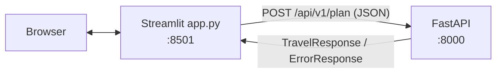

# 16 — The Streamlit frontend (Phase 12)

Files: [`frontend/app.py`](../frontend/app.py), [`frontend/api_client.py`](../frontend/api_client.py),
[`frontend/presenters.py`](../frontend/presenters.py), [`frontend/requirements.txt`](../frontend/requirements.txt)

## WHAT
A browser UI: a trip form, a "Generate itinerary" button with a progress spinner, and results in tabs
(daily schedule, budget, places & sources, quality), with clear error messages.

## WHY Streamlit, and why a separate client
- **Streamlit** turns a Python script into a web page: no HTML/JavaScript to learn. Every interaction re-runs
  the script top to bottom; `st.session_state` keeps values (the last result) between runs.
- **Separate client:** the UI calls `POST /api/v1/plan` over HTTP like any other client and imports *nothing*
  from `app/`. So the API and UI can be deployed, scaled and replaced independently (two containers in
  Stage 4/5), and the API stays the single source of truth.



## Files

| File | Responsibility | Tested by |
|---|---|---|
| `api_client.py` | `plan_trip()`: POST, timeout (180 s), maps every failure to `PlannerAPIError(code, message, request_id, details)` | `httpx.MockTransport` tests |
| `presenters.py` | pure functions: form → request JSON; response → table rows / Markdown lines; `md_escape` | plain unit tests |
| `app.py` | layout only: form, spinner, tabs, error display | Streamlit `AppTest` (runs the real script headless) |

## What the user sees

| Requirement | Where |
|---|---|
| Destination, starting city, days, dates, budget, travellers, style, interests, diet, transport, accommodation, special requirements | form |
| Loading state | `st.spinner` ("Researching live sources…") |
| Errors | `st.error(message)` + field errors (422) + missing config names (503) + `Error code · request id` |
| DEMO vs live | yellow warning banner for demo, blue info banner with retrieval time for live |
| Daily schedule | per day: date, theme, activities with 📍 place, area, `S#` source id, cost + basis |
| Budget breakdown | metrics row (total, budget, remaining, per person) + table with "how it was calculated" + assumptions |
| Recommendations, tips, "Not verified" notes | under the schedule |
| Sources | table with clickable URLs; places table shows the quote and source for every entity |
| Quality | grounding %, % of budget from sources, repair rounds, optimizer changes, discarded items, metadata |

## Security detail: escaping
Titles, descriptions and warnings come from an LLM or a web page. Rendering them as raw Markdown would let a
page turn `[click](http://evil)` into a link. `md_escape()` escapes Markdown characters, Streamlit escapes HTML
by default, and URLs are shown only through `LinkColumn` (and are http(s)-only by schema).

## Run it

```bash
# terminal 1: the API (demo or live, see README)
.venv/bin/uvicorn app.main:app --reload
# terminal 2: the UI
API_BASE_URL=http://localhost:8000 .venv/bin/streamlit run frontend/app.py   # http://localhost:8501
```

## Common mistakes
- Importing backend code into the UI: it couples deployments and skips HTTP error handling.
- No timeout on the HTTP call: the UI hangs forever if the API does.
- Calling the API outside the submit branch: Streamlit re-runs on every click, so it would re-plan (and
  re-bill) on every tab switch. Results live in `st.session_state`.
