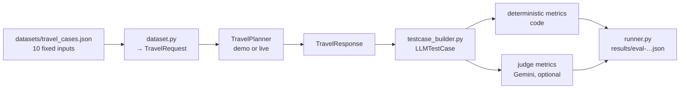

# 19 — DeepEval: how this project evaluates its LLM output

Files: [`evaluation/`](../evaluation/) (see its [README](../evaluation/README.md)), tests in
[`tests/unit/test_evaluation.py`](../tests/unit/test_evaluation.py).

## WHAT
DeepEval is an open-source Python framework for evaluating LLM applications. It provides:
- `LLMTestCase`: one example (input, actual output, retrieval context, metadata);
- **metrics** with a score, threshold, pass/fail and reason, including built-in LLM-judge metrics
  (Faithfulness, Answer Relevancy, G-Eval…) and a `BaseMetric` class for your own;
- pytest integration: `assert_test(test_case, metrics)` and `deepeval test run`.

## WHY DeepEval here
- It treats evaluation like testing: metrics, thresholds, pass/fail, the same workflow as pytest.
- `BaseMetric` lets **deterministic code checks** and **LLM-judge checks** live side by side and report the
  same way.
- Built-in `FaithfulnessMetric` matches our core question: are the itinerary's claims supported by the
  verified research?
- It can use Gemini as the judge (`deepeval.models.GeminiModel`), so no second provider is required.

We do **not** use Confident AI (DeepEval's hosted platform), and telemetry is disabled
(`DEEPEVAL_TELEMETRY_OPT_OUT=YES`, set in `evaluation/__init__.py` and `tests/conftest.py`). Reports stay local.

## Architecture



`LLMTestCase` fields we fill:
- `input`: the request rendered as a sentence ("Plan a 4-day couple trip to Goa…");
- `actual_output`: the itinerary rendered as text (titles, descriptions, tips, total);
- `retrieval_context`: the verified research (entity names, areas, descriptions, quoted prices,
  destination overview). This is the evidence the faithfulness judge compares against;
- `metadata`: the full structured request and response, read by deterministic metrics.

## Metrics

| Metric | Kind | Criterion | Threshold* |
|---|---|---|---|
| `entity_grounding` | code | every activity is a verified entity (traceable to a returned source) or an explicit `generic_kind` | 1.0 |
| `unsupported_places` | code | no text names a place absent from verified research (same detector as the app) | 1.0 |
| `completeness` | code | days 1..N, no empty day, dates if requested, title/summary, all budget categories, sources | 1.0 |
| `budget_constraint` | code | lines sum to total; remaining and per-person exact; currency; over-budget never hidden | 1.0 |
| `constraint_adherence` | code | pace cap, no repeated attraction, rooms for group size, dietary confirmed or flagged | 1.0 |
| `preference_match` | code (coarse) | share of interests served by a scheduled verified place | 0.6 |
| `research_traceability` | code | (research suite) every entity's name and price quote appear in its cited source | 1.0 |
| `Faithfulness` | LLM judge (DeepEval built-in) | claims in the itinerary supported by `retrieval_context` | 0.7 |
| `itinerary_coherence` | LLM judge (G-Eval) | clear daily focus, sensible order, realistic pace | 0.6 |
| `preference_alignment` | LLM judge (G-Eval) | interests, style, diet, pace addressed or honestly declined | 0.6 |
| `usefulness` | LLM judge (G-Eval) | actionable, clear, honest about uncertainty | 0.6 |

\* **INITIAL ENGINEERING THRESHOLDS**: developer-chosen starting points, not a validated benchmark. Code
metrics use 1.0 because a rule either holds or not. Judge thresholds are softer because judges are noisy.
Tune them once there is a larger set of live runs, ideally with human ratings. Override with
`EVAL_THRESHOLD_<NAME>`.

### Why some evaluation must stay deterministic
"Is ₹12,000 + ₹9,600 + ₹1,600 + ₹0 + ₹100 + ₹2,330 = ₹25,630?" has one right answer. Code checks it in
microseconds for free. An LLM judge might say yes when it's no, and charges for the privilege. The same
goes for "is A99 a verified id?" and "are there 4 days?". Judges are used only where judgement is needed.

## LLM-as-a-judge
**What:** a (usually strong) LLM is given the input, the output and a rubric, and asked for a score and a
reason. G-Eval turns a rubric into evaluation steps and scores with the model's token probabilities.

**Why:** some qualities (coherence, usefulness, fit to a family's needs) have no formula.

**Limitations (documented, not hidden):**

| Issue | What it means here | Mitigation |
|---|---|---|
| Judge / self-preference bias | Gemini judging Gemini tends to rate its own style higher | set `EVAL_JUDGE_MODEL` to a different model; compare with human ratings |
| Model bias | judges favour long, confident text | rubric penalises filler; deterministic checks catch confident errors |
| Prompt sensitivity | rewording a rubric shifts scores | rubrics are versioned in code; compare runs with the same rubric only |
| Non-determinism | same input → different scores | judge temperature 0; compare averages over the dataset, not single cases |
| Cost | ≥ 4 extra LLM calls per case (Faithfulness makes several) | `--judge` is opt-in; run on releases, not every commit |

The judge is a **signal, not ground truth**.

## Dataset
`datasets/travel_cases.json`: 10 fixed **inputs** (Goa ×3, Hyderabad, Jaipur ×2, Delhi ×2, Bengaluru ×2;
couple, family, solo, friends, business; hostel → luxury; dietary needs; a 1-day edge case). Each has an
`expected_behavior` sentence for humans. **No expected itineraries and no API results are stored**: outputs
are generated at evaluation time, which keeps the dataset honest as the web changes.

| Concept | Where |
|---|---|
| test input | `cases[].request` |
| expected behaviour | `cases[].expected_behavior` (human-readable) + metric definitions |
| actual model output | report → `cases[].actual_output` |
| evaluation result | report → `cases[].metrics[]` |

## Running it
See `evaluation/README.md`. Modes are explicit (`--mode demo|live`). No silent fallback.

## Results so far (exact)

**Demo evaluation, run during Stage 4** (`python -m evaluation.runner --mode demo`, 10 cases):
**8/10 cases passed all metrics**. `entity_grounding`, `unsupported_places`, `completeness`,
`budget_constraint`, `constraint_adherence`: 1.00 on all 10. `preference_match`: mean 0.85, pass rate 80%,
failing `bengaluru_solo_adventure` ("not covered ['adventure', 'nature']") and `goa_family_jain_homestay`
(nature not covered). These failures are **correct**: the invented demo data has no adventure or nature
places, and the metric caught that.

> **Demo scores measure pipeline mechanics only. They say nothing about Gemini or Tavily quality.**
> Judge metrics: **NOT RUN, GEMINI_API_KEY not available.** Live evaluation: **NOT RUN, API keys not
> available.** No real-model scores exist yet.

Report excerpt (real):
```json
{"mode": "demo",
 "mode_notice": "DEMO EVALUATION: invented offline data and a rule-based demo model. Measures pipeline mechanics only; scores say NOTHING about real Gemini/Tavily quality.",
 "configuration": {"model": "demo-model", "planner_prompt": "itinerary-planner-v2", "research_prompt": "research-extraction-v1", "max_repair_attempts": 2},
 "judge": {"enabled": false, "model": null, "status": "NOT RUN: --judge not requested"},
 "threshold_status": "INITIAL ENGINEERING THRESHOLDS: not validated; tune on a larger evaluation dataset"}
```
```json
{"case_id": "bengaluru_solo_adventure", "status": "evaluated",
 "metrics": [{"name": "preference_match", "kind": "deterministic", "score": 0.0, "threshold": 0.6, "passed": false,
              "explanation": "covered []; not covered ['adventure', 'nature']"}]}
```

## BEGINNER EXPLANATION
DeepEval is the exam system. The dataset is the question paper (10 trip requests). Deterministic metrics are
the multiple-choice questions, marked by a machine. LLM-judge metrics are the essay questions, marked by
another AI examiner who is useful but sometimes inconsistent, so we don't treat their marks as final truth.
