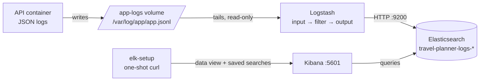

# 20 — The ELK stack: Elasticsearch, Logstash, Kibana (Phases 4.18–4.21)

Files: [`monitoring/elk/`](../monitoring/elk/), services in [`docker-compose.yml`](../docker-compose.yml) (profile `elk`).

> **Status: configuration written and statically tested, NOT RUN.** Docker is not installed on the build
> machine, so the stack has never been started by the author. `tests/unit/test_container_config.py` checks
> consistency (paths, versions, field mappings), and the Kibana setup payloads were validated with a fake curl,
> but none of this proves the stack works end to end. Run it and follow "Verify" below.

## What each part is

| | What it is | Analogy | In this project |
|---|---|---|---|
| **Elasticsearch** | a search engine and database for JSON documents, very fast at filtering and aggregating | a library with an instant index of every word | stores each log line as a document in `travel-planner-logs-YYYY.MM.DD` |
| **Logstash** | a data pipeline: input → filter → output | a mail-sorting room | tails the API's JSON log file, cleans fields, ships to Elasticsearch |
| **Kibana** | a web UI over Elasticsearch: search, charts, dashboards | the library's reading room | Discover searches + charts at http://localhost:5601 |



**Why a log file and not the network?** The API doesn't know or care whether Logstash exists: it writes to
stdout and a file. If Logstash is down, nothing in the request path slows or fails, and Logstash catches up
from the file when it returns (the `sincedb` remembers its position). On Kubernetes/GCP (docs/24) stdout is
collected by the platform instead.

## Logstash pipeline (`logstash/pipeline/travel-planner.conf`)

| Section | What it does | Why |
|---|---|---|
| **input** `file { path => "/var/log/app/app.jsonl", codec => json, start_position => "beginning", sincedb_path => … }` | reads each new line as a JSON event | the app already writes JSON, so no regex parsing is needed |
| **filter** `_jsonparsefailure` → `event_type: unparsed` | keeps broken lines, tagged | nothing silently lost |
| **filter** `date { match => ["timestamp","ISO8601"], target => "@timestamp" }` | event time = when the app logged it | not when Logstash happened to read it |
| **filter** `mutate convert` | status/latency/tokens forced to numbers | consistent types every day |
| **filter** `mutate remove_field` | drops file-input bookkeeping and any `api_key`, `authorization`, `password`, `secret`, `prompt`, `messages` field | defence in depth: the app never logs them; this ensures they never get indexed |
| **output** `elasticsearch { index => "travel-planner-logs-%{+YYYY.MM.dd}", manage_template => true, template => … }` | writes to a daily index; installs our mapping first | explicit field types; deleting old days is trivial |

`logstash.yml` disables X-Pack monitoring and ECS compatibility. ECS mode would add fields like `event.*` that
clash with ours.

## Elasticsearch concepts

| Term | Meaning here |
|---|---|
| **document** | one log event (one JSON line) |
| **field** | a key in it: `event_type`, `latency_ms`, `request_id` |
| **index** | a collection of documents; we create one per day: `travel-planner-logs-2026.10.01` |
| **mapping** | the type of each field. `elasticsearch/travel-planner-logs.template.json` maps numbers and booleans explicitly (`status: integer`, `latency_ms: float`, `demo_mode: boolean`); other strings default to `keyword` (exact-match, aggregatable); `message` is `text` (full-text); `stack_trace` is stored but not indexed |
| **index template** | the mapping applied automatically to every new `travel-planner-logs-*` index |
| **query** | e.g. KQL in Kibana: `event_type : "llm_call" and not outcome : "ok"` |

A test runs a real demo request and asserts that **every non-string field the app logs is mapped explicitly**,
so a new numeric field can't silently become a string mapping.

**Retention (local):** nothing is deleted automatically. Delete old days with
`curl -X DELETE 'localhost:9200/travel-planner-logs-2026.09.*'`. In production you'd use Index Lifecycle
Management (e.g. delete after 30 days); not configured here, on purpose (local only). Single node,
`number_of_replicas: 0` (no replica can exist on one node). **Security is disabled (local development only).**
Ports are bound to 127.0.0.1.

## Kibana

`elk-setup` (one-shot curl container) creates the data view `travel-planner-logs-*` and six saved Discover searches:
Requests, Failed requests, LLM call failures, Search failures, Itinerary repairs, Completed plans.

| Question | Where / KQL | Visualisation (Lens, manual) |
|---|---|---|
| Request count | `event_type : "request_completed"` | Count over `@timestamp`, broken down by `route` |
| Errors | `event_type : "request_completed" and status >= 400` | Count by `error_code` (bar) |
| Latency | `event_type : "request_completed" and route : "/api/v1/plan"` | Median and 95th percentile of `latency_ms` over time |
| LLM failures | `event_type : "llm_call" and not outcome : "ok"` | Count by `outcome`, split by `purpose` |
| LLM latency / tokens | `event_type : "llm_call"` | Average `latency_ms` and sum of `input_tokens` by `purpose` |
| Search failures | `event_type : "search_call" and outcome : "error"` | Count by `provider` and `error_code` |
| Repair attempts | `event_type : "itinerary_validated"` | Count by `passed`, split by `attempt` (0 = first draft) |
| Popular destinations | `event_type : "plan_completed"` | Top values of `destination` (table) |
| Trace one request | `request_id : "<id from X-Request-ID header>"` | Discover, sorted by `@timestamp` ascending |

Dashboards are **not** auto-created: Lens saved-object JSON is version-specific and couldn't be tested here.
Build them from the table in a few minutes (Analytics → Dashboard → Create visualization).

## Run and verify

```bash
docker compose --profile elk up --build -d             # needs ~3 GB free RAM
docker compose ps                                       # elasticsearch/logstash/kibana "healthy", elk-setup "exited (0)"
curl -s -X POST localhost:8000/api/v1/plan -H 'Content-Type: application/json' \
  -d '{"destination":"Goa","num_days":2,"budget":20000}'          # with DEMO_MODE=true in .env
curl -s 'localhost:9200/travel-planner-logs-*/_count?q=event_type:request_completed'
docker compose logs elk-setup                           # "Kibana setup complete"
# open http://localhost:5601 → Discover → "Travel planner logs"
```

Troubleshooting: Elasticsearch exits with code 137 (out of memory: free RAM or lower `ES_JAVA_OPTS`);
`count: 0` (check `docker compose logs logstash`; the API must have `LOG_FILE` set and have served a request);
Kibana "server not ready" for a minute or two after start is normal.
