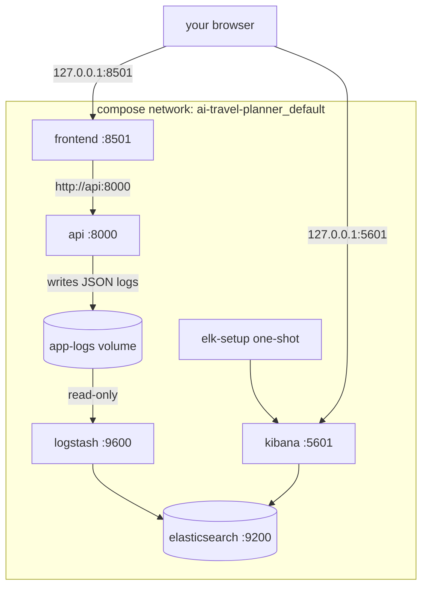

# 22 — Docker Compose: the local stack (Phases 4.23, 4.26)

File: [`docker-compose.yml`](../docker-compose.yml).

> **Status: NOT RUN (Docker not installed on the build machine).** The YAML is parsed and checked by
> `tests/unit/test_container_config.py`; `docker compose config` and `up` have not been run by the author.

## What is Docker Compose?
A file that describes several containers, how they connect, and how to start them together with one command.
Without it you'd run five long `docker run` commands in the right order with the right networks and volumes.



## Services

| Service | Image | Starts with | Purpose |
|---|---|---|---|
| `api` | built from `Dockerfile` | default | FastAPI planner |
| `frontend` | built from `frontend/Dockerfile` | default; waits until `api` is **healthy** | Streamlit UI |
| `elasticsearch` | `elasticsearch:8.19.22` | `--profile elk` | log storage |
| `logstash` | `logstash:8.19.22` | `--profile elk`; waits for ES healthy | log pipeline |
| `kibana` | `kibana:8.19.22` | `--profile elk`; waits for ES healthy | log UI |
| `elk-setup` | `curlimages/curl:8.22.0` | `--profile elk`; waits for Kibana healthy; exits | data view + saved searches |

ELK is a **profile** because it needs ~3 GB RAM. `docker compose up` gives the light API + UI stack;
`docker compose --profile elk up` adds logging.

## Networking
Compose creates one bridge network for the project. Each service is reachable **by its service name** as a
hostname: the UI uses `http://api:8000`, Logstash uses `http://elasticsearch:9200`. Nothing inside the network
needs published ports. Published ports exist only for you, and all are bound to `127.0.0.1` (not reachable
from other machines; important because ES/Kibana have security disabled locally).

| Host port | Service | Why published |
|---|---|---|
| 127.0.0.1:8000 | api | curl, `/docs` |
| 127.0.0.1:8501 | frontend | the UI |
| 127.0.0.1:9200 | elasticsearch | inspect indices with curl |
| 127.0.0.1:5601 | kibana | dashboards |

## Environment variables
- `api` reads `.env` at **run time** via `env_file: {path: .env, required: false}` (Compose ≥ 2.24). Put
  `GEMINI_API_KEY`/`TAVILY_API_KEY` or `DEMO_MODE=true` there. Compose then sets `LOG_FORMAT=json` and
  `LOG_FILE=/var/log/app/app.jsonl`.
- `frontend` gets only `API_BASE_URL`; it never sees API keys.
- ELK services get JVM heap sizes and local-only settings (`discovery.type=single-node`,
  `xpack.security.enabled=false`).
- `GIT_SHA` (build arg) can be passed: `GIT_SHA=$(git rev-parse --short HEAD) docker compose build`.

## Volumes
| Volume | Mounted in | Purpose |
|---|---|---|
| `app-logs` | api (rw) at `/var/log/app`, logstash (ro) | the JSON log file shared from producer to consumer |
| `es-data` | elasticsearch | indices survive `docker compose down` (removed by `down -v`) |
| `logstash-data` | logstash | read position (`sincedb`), so restarts don't re-ingest |
| bind mounts `./monitoring/elk/...` | logstash, elk-setup | pipeline, settings, index template, setup script (read-only) |

## Full-stack test procedure (Phase 4.26, to be run where Docker is available)
```bash
echo "DEMO_MODE=true" >> .env
docker compose --profile elk up --build -d
docker compose ps                                              # 1-5: all running; health "healthy"
curl -s localhost:8000/api/v1/health                           # 6: {"status":"ok",...}
curl -s localhost:8000/api/v1/health/ready                     #    200 in demo mode
curl -s -o /dev/null -w '%{http_code}\n' localhost:8501        # 7: 200
curl -s -X POST localhost:8000/api/v1/plan -H 'Content-Type: application/json' \
  -d '{"destination":"Goa","num_days":3,"budget":20000,"num_travelers":2}' | head -c 300   # 8
sleep 10; curl -s 'localhost:9200/travel-planner-logs-*/_count?q=event_type:plan_completed'  # 9: count >= 1
# 10: http://localhost:5601 → Discover → "Travel planner logs" → search request_id from step 8
docker compose --profile elk down          # keep data;  add -v to delete volumes
```
