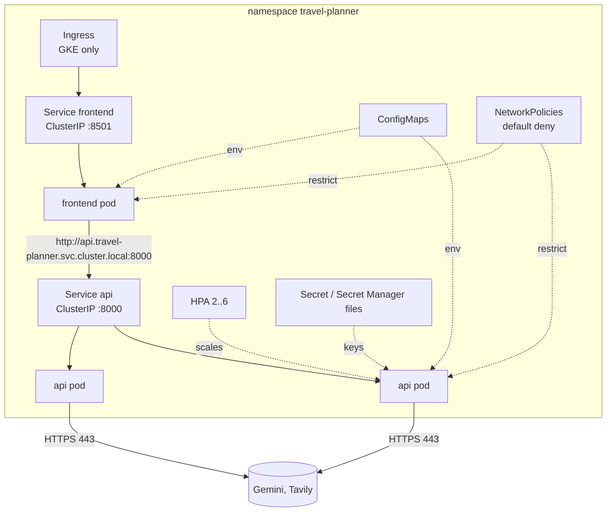

# 23 — Kubernetes (Phases 5.3–5.10, 5.35)

Files: [`infrastructure/kubernetes/`](../infrastructure/kubernetes/) (`base/`, `overlays/local/`, `overlays/gke/`).

> **Status.** **NOT RUN on a cluster**: no kubectl, kind, minikube or GKE access on the build machine.
> **VERIFIED statically:** both overlays render with kustomize v5.8.2 and pass `kubeconform -strict` against
> Kubernetes 1.33 schemas, including the GKE custom resources (31/31 valid). `tests/unit/test_kubernetes_manifests.py`
> (16 tests) checks probes against real API routes, ConfigMap keys against `Settings`, security contexts, exposure
> and shutdown timing.

## The basics, using this project

| Concept | Plain explanation | In this project |
|---|---|---|
| **Kubernetes** | software that runs containers across many machines and keeps them in the state you describe | runs the API and UI images built in Stage 4 |
| **Why** | Docker runs a container; Kubernetes keeps N copies running, replaces crashed ones, spreads them over machines, rolls out new versions without downtime, and scales them | the API must survive a crash or node failure and scale with traffic |
| **Cluster** | the whole set of machines plus the control plane that manages them | a kind cluster on a laptop, or GKE Autopilot |
| **Node** | one machine (VM) in the cluster | GKE adds or removes nodes for us (Autopilot) |
| **Pod** | the smallest unit: one or more containers sharing a network address | one API container per pod |
| **Deployment** | "keep N pods of this template running; replace them gradually on update" | `api` (2 replicas), `frontend` (1) |
| **Replica** | one copy of the pod | 2 API replicas: one can fail or be updated while the other serves |
| **Service** | a stable name and IP in front of a changing set of pods | `api` → `api.travel-planner.svc.cluster.local:8000` |
| **Ingress** | HTTP(S) entry from the internet to a Service | GKE overlay: Google load balancer → `frontend` only |
| **ConfigMap** | non-secret configuration injected as env vars | `api-config` (model, providers, limits), `frontend-config` (API URL) |
| **Secret** | sensitive values, kept separately from config, with tighter access | local: `api-secrets`; GKE: Secret Manager files instead (docs/24) |
| **HPA** | HorizontalPodAutoscaler: adds or removes replicas based on a metric | API 2..6 replicas on CPU |
| **Liveness probe** | "is the process alive?" If it fails repeatedly, restart the container | `GET /api/v1/health` (no external calls) |
| **Readiness probe** | "should it receive traffic now?" If it fails, remove it from the Service; don't restart it | `GET /api/v1/health/ready` (keys configured?) |
| **Startup probe** | holds off liveness checks while the app starts | `/api/v1/health`, up to 60 s |

## Architecture



## Files (`base/`)

| File | What and why |
|---|---|
| `namespace.yaml` | one namespace: easy to list, secure and delete together |
| `service-account.yaml` | one identity per workload; `automountServiceAccountToken: false` because neither pod talks to the Kubernetes API |
| `configmap.yaml` | non-secret settings. Every key is a real `Settings` field (tested). `API_BASE_URL` uses the Service DNS name, not an IP |
| `secret.example.yaml` | **placeholders only**, not part of kustomize. Real local secrets come from `kubectl create secret` |
| `api-deployment.yaml` | the API (details below) |
| `api-service.yaml` | **ClusterIP**: internal only. The API has no authentication, so it is never exposed |
| `frontend-deployment.yaml` | Streamlit, 1 replica (sessions live in pod memory) |
| `frontend-service.yaml` | ClusterIP; reached through the Ingress (GKE) or `port-forward` (local) |
| `hpa.yaml` | API autoscaling 2→6 at 60% CPU of the request |
| `pdb.yaml` | PodDisruptionBudget: node maintenance can't take all API pods at once |
| `network-policy.yaml` | default deny; UI→API:8000; API→HTTPS:443 (except the metadata server); DNS |
| `kustomization.yaml` | lists the resources; overlays build on it |

Overlays: **local** turns `DEMO_MODE` on and uses locally loaded images. **gke** sets `APP_ENV=prod`, Artifact
Registry image names, the Secret Manager volume, Ingress and BackendConfig (docs/24).

## The API Deployment, explained

| Setting | Value | Why |
|---|---|---|
| `replicas` | 2 | survive one pod or node failure; equals HPA minimum |
| `strategy` | `maxUnavailable: 0, maxSurge: 1` | a deploy adds a new pod before removing an old one, so capacity never drops |
| `resources.requests` | 200m CPU, 256Mi | scheduler reservation. **Measured** locally: ~116 MiB RSS idle in demo mode; headroom for real HTTP clients |
| `resources.limits` | 1 CPU, 512Mi | a runaway process is throttled or OOM-killed instead of starving neighbours |
| `startupProbe` | `/api/v1/health`, 30×2 s | startup measured at 1.6 s locally; generous for cold nodes |
| `livenessProbe` | `/api/v1/health` every 10 s | restart only if the process itself is stuck |
| `readinessProbe` | `/api/v1/health/ready` every 10 s | missing keys mean "not ready" (no traffic), not "restart forever" |
| `preStop: sleep 5` + `terminationGracePeriodSeconds: 75` | — | gives the Service time to stop routing, then uvicorn's `--timeout-graceful-shutdown 60` lets in-flight plans (tens of seconds of LLM calls) finish |
| `securityContext` | non-root uid 10001, read-only root FS, drop ALL capabilities, no privilege escalation, seccomp RuntimeDefault | if the app is compromised, the attacker can't write to the image, gain capabilities or become root. `/tmp` is the only writable path (emptyDir) |
| `topologySpreadConstraints` | prefer different nodes | one node failure doesn't take both replicas |
| `envFrom` | ConfigMap + optional Secret | config and secrets are injected, never baked into the image |

**Why liveness ≠ readiness:** if Gemini keys are missing, restarting won't help. The pod should stay alive
(debuggable, `kubectl logs`) but receive no traffic. If the process deadlocks, it should be restarted. One
endpoint per question. Neither probe calls Gemini or Tavily: probes run every 10 s per pod, which would cost
money, hit rate limits, and make our health depend on theirs.

## Why the UI is a separate Deployment
Different needs: the API is stateless and scales horizontally; Streamlit holds per-user session state in
memory over a websocket. Separate Deployments mean separate replica counts, resources, rollouts and network
rules. Only the UI is internet-facing. **Scaling the UI beyond 1 replica** requires sticky sessions (the GKE
BackendConfig sets cookie affinity for that case).

## Services: ClusterIP vs LoadBalancer vs Ingress

| Type | Reachable from | Used here |
|---|---|---|
| ClusterIP | inside the cluster only | **both** Services |
| NodePort | every node's IP on a high port | not used |
| LoadBalancer | the internet, one cloud LB per Service | not used: one Ingress is cheaper and adds HTTPS |
| Ingress | the internet via an HTTP(S) LB with routing and TLS | GKE: UI only |

## Security summary
Non-root, read-only filesystem, all capabilities dropped, no SA token, NetworkPolicy default-deny, secrets
outside ConfigMaps, API not exposed. **NetworkPolicy needs a CNI that enforces it**: GKE Autopilot / Dataplane V2
yes; kind's default kindnet **no** (policies are silently ignored there; use Calico or Cilium to test them
locally).

## HPA and its tuning
- **Why scale the API:** each plan holds a request open for tens of seconds and `MAX_CONCURRENT_PLANS` caps each
  replica at 8. More users need more replicas.
- **Metric:** average CPU at 60% of the 200m request. On traffic growth: CPU rises → HPA adds pods (up to 6) →
  the Service spreads requests. After 5 minutes of low load it removes them.
- **Honest caveat:** this workload mostly *waits* on Gemini, so CPU under-reports load. Better signals: in-flight
  requests or `rate_limited_total{reason=busy}` exported as a custom metric (Prometheus adapter / Cloud
  Monitoring). Tune after measuring real traffic.
- **NOT VERIFIED:** needs the metrics API (built into GKE; `metrics-server` on kind). Not run.

## Run on a local cluster (kind), to be executed where Docker is available

```bash
kind create cluster --name travel-planner
docker build -t ai-travel-planner-api:local .
docker build -t ai-travel-planner-frontend:local -f frontend/Dockerfile .
kind load docker-image ai-travel-planner-api:local ai-travel-planner-frontend:local --name travel-planner
kubectl apply -k infrastructure/kubernetes/overlays/local          # DEMO_MODE=true: no keys needed
kubectl -n travel-planner get pods,svc,deploy,hpa                   # pods READY 1/1
kubectl -n travel-planner describe pod -l app=api                   # probe events
kubectl -n travel-planner logs deploy/api | head                    # JSON logs
kubectl -n travel-planner port-forward svc/frontend 8501:8501       # http://localhost:8501
# Real keys instead of demo mode:
kubectl -n travel-planner create secret generic api-secrets \
  --from-literal=GEMINI_API_KEY=... --from-literal=TAVILY_API_KEY=...
kubectl -n travel-planner patch configmap api-config -p '{"data":{"DEMO_MODE":"false"}}'
kubectl -n travel-planner rollout restart deploy/api
```

**Verification checklist (NOT RUN):** pods Ready · readiness 200 in demo · UI loads via port-forward · a plan
succeeds · `kubectl delete pod -l app=api` → a replacement starts and traffic continues (self-healing).

## Static validation (what was actually run)
```bash
kustomize build infrastructure/kubernetes/overlays/local | kubeconform -strict -summary -kubernetes-version 1.33.0 -schema-location default -
#  Summary: 14 resources found - Valid: 14, Invalid: 0, Errors: 0, Skipped: 0
kustomize build infrastructure/kubernetes/overlays/gke   | kubeconform ... (+ CRDs-catalog schemas)
#  Summary: 17 resources found - Valid: 17, Invalid: 0, Errors: 0, Skipped: 0
```
The same validation runs in CI (`manifests` job).
