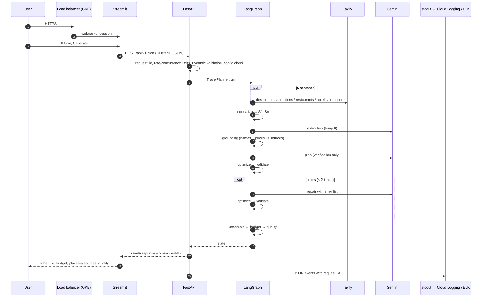

# Final request flow: one Goa trip, browser to logs

One request (Goa, 4 days, ₹25,000, 2 travellers, couple, beaches/food/nightlife, from Bengaluru) through every
layer. JSON at each step: [REQUEST_FLOW.md](REQUEST_FLOW.md) and [11_request_to_research_flow.md](11_request_to_research_flow.md).
Steps 1–18 are **VERIFIED** in demo mode and with faked providers; real Tavily/Gemini behaviour is **NOT RUN**.
Step 19 on GKE is **DOCUMENTED ONLY**.

| # | Step | Where in code | What happens | Data out |
|---|---|---|---|---|
| 1 | User | browser | opens the UI URL | — |
| 2 | Edge | GKE Ingress → load balancer (docs/24) | HTTPS, optional Cloud Armor; websocket kept open (BackendConfig 1 h) | — |
| 3 | Streamlit | `frontend/app.py`, `presenters.build_payload` | form → request JSON | `TravelRequest` JSON |
| 4 | HTTP client | `frontend/api_client.plan_trip` | POST to `API_BASE_URL` (Service DNS), 180 s timeout, errors → `PlannerAPIError` | — |
| 5 | Network policy | `network-policy.yaml` | only frontend pods may reach api:8000 | — |
| 6 | Middleware | `app/api/middleware.py` | `request_id`, `RequestStats`, timer | `X-Request-ID` |
| 7 | Limits | `app/api/limits.py` | per-client rate (20/min), per-replica concurrency (8) → 429 + Retry-After | — |
| 8 | Validation | `app/schemas/request.py` | ranges, enums, place-name characters, dates → 422 if invalid; no money spent | `TravelRequest` |
| 9 | Configuration | `services/common.require_configuration` | keys present (env or Secret Manager files) else 503; never a silent demo fallback | providers |
| 10 | Research | `graph/research_graph.py`, `research/queries.py` | 5 fixed queries; 5 parallel `search_call`s; one failing category → `partial` | `SearchHit` S1..Sn |
| 11 | Tavily | `tools/search/tavily.py` | HTTPS POST, errors mapped (timeout 504, auth 502, 429) | provider-neutral items |
| 12 | Gemini extraction | `llm/client.py`, `prompts/research_prompt.py` | schema-bound JSON, validated, 1 retry, `llm_call` logged | `ResearchExtraction` |
| 13 | Grounding | `research/grounding.py` | drop entities not mentioned in their cited source; drop unverifiable prices; assign ids | `ResearchResult` + `GroundingReport` |
| 14 | Planning | `graph/planning_graph.py`, `prompts/planner_prompt.py` | Gemini picks verified ids or generic kinds; no titles or prices | `ItineraryDraft` |
| 15 | Optimizer | `planning/optimizer.py` | slot order, no repeat attractions, slot and pace caps, backtracking flag | draft + notes |
| 16 | Validator | `planning/validator.py`, `named_places.py` | hard errors (ids, days, place-or-generic, unverified names) / warnings | issues |
| 17 | Repair | `planning_graph.repair_itinerary` | ≤ 2 rounds with the exact error list; else 502 `ITINERARY_INVALID` | corrected draft |
| 18 | Assemble, budget, quality | `planning/assembler.py`, `budget.py`, `quality.py` | code-generated titles, dates, verified costs; deterministic budget; grounding ratios | `TravelResponse` |
| 19 | Logging | `observability/logging.py` | every step above emits JSON with `request_id` and `severity` → stdout → **Cloud Logging** (GKE) or file → **Logstash → Elasticsearch → Kibana** (compose) | logs |
| 20 | Metrics | `observability/metrics.py` | counters and latencies at `/api/v1/metrics`; on GKE, log-based metrics in Cloud Monitoring | metrics |
| 21 | Infrastructure | `Dockerfile`, `infrastructure/kubernetes/` | the API runs as 2–6 non-root, read-only pods behind a ClusterIP Service; probes `/health` (liveness) and `/health/ready` (readiness); HPA on CPU | — |

**Failure at any step** returns the standard `{"error": {"code", "message", "request_id", "details"}}`. The full
failure table, with what is logged and which metric changes, is in [../FINAL_PROJECT_REPORT.md](../FINAL_PROJECT_REPORT.md).
