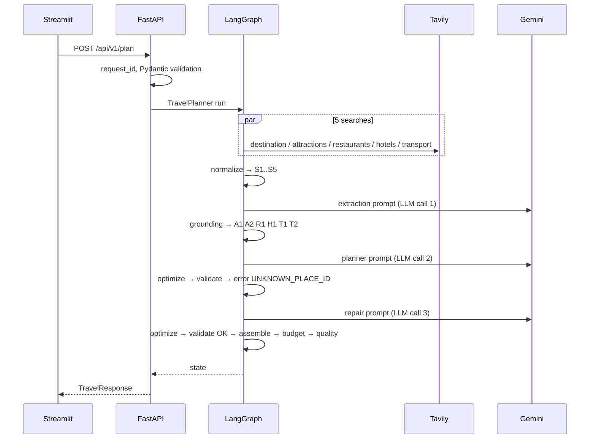

# Request flow — one Goa request from form to itinerary

> **Data on this page.** All JSON below is the **actual output of this repository's code**. The inputs that
> would normally come from Tavily and Gemini are **hand-written fixtures** (`tests/fakes.py`), because no live
> API keys were available while building. They are not recorded API responses and are not travel facts. The
> planner fixture's first draft is deliberately invalid, to show the repair loop.
> Regenerate with real data: put keys in `.env`, run the API, and POST the request below.

**User:** Goa · 4 days from 12 Nov 2026 · ₹25,000 total · 2 travellers · couple · beaches, food, nightlife · from Bengaluru by train.



## Steps 1–9: request → verified research
Covered in detail, with JSON at every step, in [`11_request_to_research_flow.md`](11_request_to_research_flow.md).
Result: verified entities

| id | name | area | verified price | source |
|---|---|---|---|---|
| A1 | Baga Beach | North Goa | — | S2 |
| A2 | Fort Aguada | Candolim | "₹50 per person" | S2 |
| R1 | Fisherman's Wharf | Cavelossim | "₹1,500" (for two) | S3 |
| H1 | Example Bay Resort | Calangute | — (model's price didn't match the quote → removed) | S4 |
| T1 | overnight train (intercity) | — | — | S5 |
| T2 | scooter rental (local) | — | "₹400 per day" | S5 |

Rejected: *Dudhsagar Falls* (`NAME_NOT_IN_SOURCE`).

## Step 10: check_research
At least one attraction or restaurant exists → continue (otherwise `NO_RESEARCH_RESULTS`, and the planner is never called).

## Step 11: generate_itinerary (LLM call 2)
The prompt contains the TRIP block, the DESTINATION OVERVIEW and ALLOWED PLACES (see `13_itinerary_planning.md`).
The first draft (fixture) starts day 1 with `"place_id": "A99"`, an id that doesn't exist.

## Steps 12–13: optimize → validate
Optimizer: nothing to change. Validator:
```json
[{"severity": "error", "code": "UNKNOWN_PLACE_ID", "message": "Day 1: 'A99' is not in ALLOWED PLACES.", "day_number": 1}]
```
`repair_attempts (0) < MAX_REPAIR_ATTEMPTS (2)` → `repair_itinerary`.

## Step 14: repair_itinerary (LLM call 3) → optimize → validate
The repair prompt adds `PREVIOUS ITINERARY` (JSON) and `PROBLEMS TO FIX: - [UNKNOWN_PLACE_ID] day 1: …`.
The corrected draft uses `A1`. It is re-optimized and re-validated: no errors → assemble.

## Step 15: assemble_itinerary
**Changes:** dates from `start_date`; areas and verified costs from the research; **titles generated by code**
from the verified place name or the generic kind (since Stage 4 the LLM writes no titles).

```json
{"day_number": 1, "calendar_date": "2026-11-12", "theme": "North Goa beaches", "activities": [
  {"slot": "morning", "activity_type": "sightseeing", "title": "Visit Baga Beach", "description": "Relax on the beach.",
   "place_id": "A1", "generic_kind": null, "area": "North Goa", "estimated_cost": null, "cost_basis": "unknown"},
  {"slot": "evening", "activity_type": "food", "title": "Dinner at Fisherman's Wharf", "description": "Goan seafood.",
   "place_id": "R1", "generic_kind": null, "area": "Cavelossim", "estimated_cost": 1500.0, "cost_basis": "source"}]}
{"day_number": 2, "calendar_date": "2026-11-13", "theme": "Fort and coast", "activities": [
  {"slot": "morning", "activity_type": "sightseeing", "title": "Visit Fort Aguada", "description": "Portuguese fort with sea views.",
   "place_id": "A2", "generic_kind": null, "area": "Candolim", "estimated_cost": 100.0, "cost_basis": "source"},
  {"slot": "afternoon", "activity_type": "transit", "title": "Get around by scooter rental", "description": "Explore on a rented scooter.",
   "place_id": "T2", "generic_kind": null, "area": null, "estimated_cost": 400.0, "cost_basis": "source"}]}
```
Days 3–4: `"title": "Free time"`, `"generic_kind": "free_time"`, description "Unplanned time at the beach near your
hotel." (a generic activity names no venue; the validator would reject an unverified name here). Accommodation:
`{"hotel_id": "H1", "name": "Example Bay Resort", "area": "Calangute", "nightly_rate": null, "cost_basis": "unknown", "rooms": 1}`.

## Step 16: calculate_budget
| category | amount | basis | detail |
|---|---:|---|---|
| accommodation | 12,000 | estimate | ₹4,000/room/night × 3 nights × 1 room(s) |
| food | 9,600 | estimate | ₹1,200/person/day × 2 × 4 days |
| local_transport | 1,600 | source | scooter rental: ₹400/day × 4 days × 1 (one per two people) (S5) |
| intercity_transport | 0 | unknown | No verified fare found from Bengaluru. |
| activities | 100 | source | 1 activity price(s) from sources |
| miscellaneous | 2,330 | estimate | 10% of subtotal ₹23,300 |

`total 25,630 · remaining −630 · within_budget false · per_person_total 12,815 · complete false`

## Step 17: quality_check
```json
{"grounded_activity_ratio": 0.667, "sourced_cost_ratio": 0.066, "repair_attempts": 1,
 "issues": [{"severity": "warning", "code": "OVER_BUDGET", "message": "Estimated total ₹25,630 exceeds the budget ₹25,000 by ₹630 (3%)."},
            {"severity": "warning", "code": "BUDGET_INCOMPLETE", "message": "Some costs are unknown and counted as 0, so the real total will be higher."}],
 "optimization_notes": []}
```

## Step 18: response (abridged)
```json
{"request_id": "5ece24f3c4bc4f1b87eb236438cb4e08", "stage": "itinerary", "status": "success", "data_mode": "live",
 "notice": "Live research retrieved … Web sources can be wrong or out of date: verify prices and opening hours before booking.",
 "itinerary": {"…": "step 15"}, "budget": {"…": "step 16"}, "research": {"…": "verified entities"},
 "sources": ["S1 … S5 with URLs"], "grounding": {"rejected": ["Dudhsagar Falls"], "prices_removed": ["H1"]},
 "warnings": ["1 extracted item(s) were discarded …", "1 price(s) were removed …",
              "Estimated total ₹25,630 exceeds the budget ₹25,000 by ₹630 (3%).",
              "Some costs are unknown and counted as 0, so the real total will be higher."],
 "quality": {"…": "step 17"},
 "metadata": {"model": "gemini-2.5-flash", "llm_calls": 3, "input_tokens": null, "output_tokens": null, "is_demo": false}}
```

## Step 19: logs and metrics
Every step above wrote one JSON log line with the same `request_id` (real output of a demo request, abridged):
```text
search_call ×5 → llm_call (research_extraction) → research_grounded (rejected 1) → llm_call (itinerary_planning)
→ itinerary_validated (attempt 0, passed=false, UNKNOWN_PLACE_ID) → itinerary_repair_requested → llm_call
(itinerary_repair) → itinerary_validated (attempt 1, passed=true) → plan_completed → request_completed
```
Metrics updated: `search_calls_total`, `llm_calls_total{purpose}`, `itinerary_first_draft_total{result=invalid}`,
`repair_attempts_total`, `repair_success_total`, `validation_failures_total{code=UNKNOWN_PLACE_ID}`,
`budget_overflow_total`. In docker-compose with `--profile elk`, Logstash ships the lines to Elasticsearch and
Kibana can show them by `request_id` (docs/18, docs/20).

## Step 20: the UI
The Streamlit app shows the blue live banner (yellow DEMO banner in demo mode), the four warnings, budget metrics,
and the tabs described in `16_frontend.md`.
